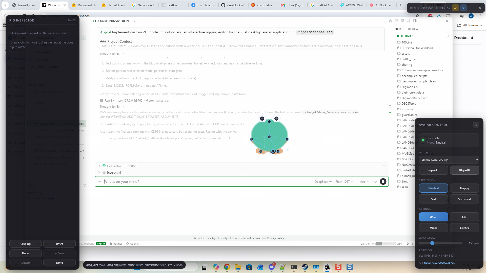

# ARCHITECTURE — char-rig desktop avatar

Technical documentation for the AI desktop avatar in `C:\hermes\char-rig`.
Everything here was read from the current sources; file names, function names,
constants and payloads are quoted from the code, not from memory.

Last verified against: `src-tauri/src/{lib,api,models}.rs`, `ui/index.html`,
`src-tauri/Cargo.toml`, `src-tauri/tauri.conf.json`, `models/*/model.json`,
`src-tauri/src/bin/{char-rig-mcp,char-rig-watcher}.rs`.

---

## 1. Project overview

A 2D character that lives on top of the Windows desktop: a transparent,
always-on-top, full-screen WebView2 window that draws a rigged sprite/shape
avatar and lets it walk around, emote, blink, talk and show speech bubbles.
A local HTTP API lets an external agent (LLM, script, automation) drive it.

### Feature summary

| Area | What exists |
| --- | --- |
| **Desktop windowing** | Transparent, borderless, always-on-top overlay covering the primary monitor; selective click-through so the desktop stays usable; custom titlebar with click-through toggle, minimize and close |
| **UI controls** | Avatar control panel (state readout, expression buttons, Wave / Idle / Walk / Center, walk-speed slider, live position, API URL), model dropdown, Import… |
| **Model importing** | Rig manifests as `.json` or `.toml`; single images (`.png`, `.jpg`/`.jpeg`, `.webp`, `.svg`) as a **new character** or as a **part attached to the current rig**; native file picker; clear validation errors |
| **Rig Edit Mode** | Bone/joint/pivot/hitbox overlay; drag joints, drag rotation ring (unlimited multi-turn), wheel rotate / shift+wheel scale; re-parent; add bone, add limb, add part, duplicate/delete; inspector for transforms, limits, z-order and animation channels; undo; save to `rig.json`; reset |
| **Facial system** | Per-part sprite **variants**, 6 expression presets (`neutral`, `happy`, `surprised`, `thinking`, `sad`, `angry`) mapping to eye/mouth variant names, procedural squash/stretch fallback, expression holds with auto-revert |
| **Custom animations** | Optional `animations` block on the rig root: named keyframe clips (`duration_ms`, `loop`, `keyframes[]`) whose per-bone deltas are sampled with smoothstep easing and composed into the transform pass; timeline bar in Rig Edit Mode (clip CRUD, duration, loop, play/stop, 0–100 % scrubber with keyframe ticks, `+ Keyframe` capture) |
| **Life signs** | Auto-blink every 3–6 s (~120 ms), talking mouth loop while a bubble is visible |
| **Speech bubbles** | Head-anchored DOM card, typewriter reveal with caret, word wrap, auto-size, edge clamping / flip, auto-dismiss |
| **Agent API** | 27 local HTTP paths (31 method routes): state, movement, expressions, speech, models, rigs, parts, joints, custom animations, shutdown |
| **Desktop awareness** | `GET /context` — foreground window title + machine-wide idle seconds (Win32 probes, safe defaults elsewhere) |
| **Event stream** | `GET /events` — Server-Sent Events over a 64-frame `tokio::broadcast` channel: `state`, `speech`, `speech_cleared`, `model`, `rig_saved`, `pose`, `part_patch`, `animate`, `interaction`; 15 s keep-alive |
| **Interactions** | Play-mode click / double-click / drag on the avatar's bounds → `notify_interaction` → `interaction` frame on the event stream |
| **MCP bridge** | `char-rig-mcp.exe` — a second binary exposing 10 tools (`avatar_speak`, `avatar_emote`, `avatar_move`, `avatar_wave`, `avatar_pose`, `avatar_get_context`, `avatar_list_models`, `avatar_switch_model`, `avatar_list_animations`, `avatar_animate`) to any MCP client over stdio JSON-RPC 2.0; stateless, forwards each call to the HTTP API and reports a down host as a readable tool error |
| **Desktop watcher** | `char-rig-watcher.exe` — a third binary that subscribes to `GET /events` and polls `GET /context` and only acts when a rule fires: an `interaction` (`double_click`/`drag_end`), a `window_title` change matching a keyword, or an `idle_return` after a long idle stretch. Per-trigger cooldowns, an immediate `/emote` ack, an optional webhook, and an optional spawned Hermes command with a one-line prompt. Exponential-backoff reconnect; **zero LLM tokens while idle** |
| **Persistence** | `models/<name>/model.json` (shipped), `rig.json` (editor override), `models/.state.json` (selected model) |

### Repository map — what is live vs. legacy

| Path | Status | Notes |
| --- | --- | --- |
| `src-tauri/` | **live** | The application (Rust + Tauri 2) |
| `ui/` | **live** | Modular frontend (see structure below) |
| `models/` | **live** | Model folders + `models/.state.json` |
| [`API.md`](API.md), [`MODEL_FORMAT.md`](MODEL_FORMAT.md), [`README.md`](README.md) | **live docs** | Endpoint reference, manifest guide, quick start (this file is the design overview) |
| `watcher_rules.json` | **live config** | Optional rules for `char-rig-watcher.exe` (interaction kinds, title keywords, idle threshold, cooldowns, ack emote, Hermes command, webhook); built-in defaults when absent |
| `avatar-editor/`, `avatar-desktop/` | legacy prototypes | Standalone HTML prototypes from earlier phases; not loaded by the app |
| `ai-avatar-bridge/` | legacy workspace | Earlier multi-crate experiment (`avatar-api`, `avatar-core`, …); separate `Cargo.toml`, not built or referenced by `src-tauri` |
| `spikes/` | legacy | Throwaway experiments (format loading, auto-rigging, wgpu mesh, ws api, llm) |
| `src/char_rig/`, `tests/`, `assets/` | empty | Leftovers |
| `src-tauri/avatar-renderer.html` | unused | Superseded by `ui/index.html`; no longer referenced by any code |

### `ui/` — modular frontend structure (no build step)

```
ui/
├── index.html          # Lean semantic HTML shell (titlebar, canvas, panels, bubble, toasts)
├── styles.css          # All CSS rules (titlebar, control panel, inspector, import modal, speech bubble, toasts)
└── js/
    ├── state.js        # Shared state objects (`avatar`, `RT`, `animation`), constants (`EXPRESSION_PRESETS`, `EXPRESSIONS`, `PRESET_STATES`, `PART_TAGS`), undo history helpers
    ├── rig.js          # Model ingestion (`applyModel`, `boneDefaults`, `rebuildOrder`, `loadImages`), skeletal FK (`animOffset`, `clampRotation`, `animationOffset`, `localRotation`, `computeWorld`), rig serialization (`serializeRig`, `serializeAnimations`)
    ├── animator.js     # Custom keyframe clips: `playAnimation`, `stopAnimation`, `sampleAnimation`, `seekAnimation`, `stepAnimation`, `captureKeyframe`, clip CRUD, finished listeners
    ├── renderer.js     # Canvas rendering pipeline (`drawFace`, `drawShape`, `drawPart`, `sortedDrawables`, `render`)
    ├── editor.js       # Rig Edit Mode overlay gizmos (`drawEditorOverlay`, `hitTest`, mouse/wheel handlers), inspector rendering/bindings (`buildInspector`, `renderInspector`, `updateInspectorValues`), bone/part authoring (`addChildBone`, `deleteBone`, `addPartFromControls`, `addLimbFromControls`, `duplicatePart`, `deletePart`, `bindExpressionSprite`, `saveRig`, `resetRig`), and the animation timeline (`buildTimeline`, `updateTimeline`, `syncTimelinePlayhead`)
    ├── speech.js       # Speech bubble lifecycle (`speak`, `updateSpeech`, `positionBubble`, `hideSpeech`)
    ├── bridge.js       # Tauri IPC commands, event listeners (`avatar-state-changed`, `emote`, `speak`, `avatar-animate`, etc.), hit-region publishing (`wireRegions`, `setClickThrough`), state sync (`reportState`, `applyRemoteState`, `applyPartPatch`)
    └── main.js         # Entry point: DOM bindings, keyboard shortcuts, `window.__avatarDebug`, `requestAnimationFrame` main loop (`step`, `frame`)
```

> **No Node/npm build step.** `src-tauri/tauri.conf.json` serves `../ui` directly into WebView2 (`frontendDist: ../ui`, `"withGlobalTauri": true`). Native ES modules (`<script type="module">`) load at runtime.

> The app is **only** `src-tauri` + `ui` + `models`. The large directories
> (`ai-avatar-bridge` ~8 GB, `avatar-desktop` ~1.4 GB) are build artifacts of
> older experiments and can be deleted.

---

## 2. System architecture & threading model

```
┌─────────────────────────────────────────────┐
│ WebView2 page  (ui/index.html, embedded)    │
│  • canvas render loop (requestAnimationFrame)│
│  • avatar behaviour: idle wander / walk /    │
│    wave / blink / talk / custom clips        │
│  • rig editor + inspector + speech bubble    │
│  • publishes hit regions, reports state 8 Hz │
│  • click/double-click/drag detection         │
└───────────────┬─────────────────────────────┘
                │  invoke(cmd, args)  ▲  events
                │  (29 Tauri commands)│  (9 event names)
┌───────────────▼─────────────────────┴───────┐
│ Tauri main process (Rust)                    │
│  AppCtx   — avatar state, hit regions,       │
│             speech slot, click-through flags, │
│             SSE broadcast channel (64)        │
│  ModelCtx — current model, rig cache, pose,  │
│             joint angles, part patches        │
│  cursor tracker thread (35 ms poll)          │
└───────────────┬─────────────────────────────┘
                │ Arc<AppCtx> / Arc<ModelCtx>
┌───────────────▼─────────────────────────────┐
│ API thread "avatar-api"                      │
│  private Tokio runtime (2 workers)           │
│  axum 0.7 — 24 routes on 127.0.0.1:8765      │
│  ↳ GET /events fans the broadcast out as SSE │
└─────────────────────────────────────────────┘
```

### Threads

| Thread | Created in | Loop / lifetime | Job |
| --- | --- | --- | --- |
| main (Tauri/wry) | Tauri | event loop for the app's lifetime | Window + WebView2 event pump |
| WebView2 renderer | WebView2 | page lifetime | All rendering/animation/UI logic in JS |
| `avatar-api` | `api::start` | until `oneshot` shutdown fires | Owns a 2-worker Tokio runtime running `axum::serve` |
| `avatar-api-rt` workers | Tokio | runtime lifetime | Request handlers |
| `avatar-cursor` | `spawn_cursor_tracker` | until `AppCtx::running` is false | Global cursor poll + click-through toggling |

Nothing on the API side ever touches the GUI thread directly: handlers mutate
shared state and emit Tauri events; the page applies them on its next frame.

### Startup sequence (`lib.rs::run`)

1. `AppCtx::new(api_port())` — port from `CHAR_RIG_API_PORT`, else `8765`.
2. `ModelCtx::new()` — resolves `models_root()` and the saved selection.
3. Create a `tokio::sync::oneshot` pair; store the sender in `AppCtx`.
4. `tauri::Builder` → `manage(AppCtx)`, `manage(ModelCtx)`, register 29 commands.
5. `setup`:
   * Resize/move the window to the primary monitor using `Physical` position/size.
   * `model_ctx.ensure_loaded()` (logs a warning and falls back if a model is broken).
   * `api::start(...)` → binds, spawns the API thread, stores the URL, emits `api-status`.
   * `spawn_cursor_tracker(...)`.
6. `app.run(...)` → on `RunEvent::ExitRequested | Exit` call `AppCtx::request_shutdown()`
   (stops the tracker, fires the oneshot, graceful axum shutdown).

### State ownership and data flow

`AvatarState` (in `AppCtx.avatar`) is the API-visible truth:

```rust
pub struct AvatarState {
    pub position: (f64, f64),          // rendered as [x, y]
    pub target_position: (f64, f64),
    pub state: String,                 // idle | walking | waving
    pub expression: String,            // see AVATAR_EXPRESSIONS
    pub revision: u64,                 // bumped on every command/API mutation
    pub talking: bool,                 // reported by the page
}
```

Two directions, deliberately asymmetric:

* **Rust → page**: commands/API mutate state, then `publish()` bumps `revision`,
  emits `avatar-state-changed` with the whole struct, and (for expressions /
  speech) emits a dedicated event.
* **Page → Rust**: `report_state` is invoked at ~8 Hz (throttled to 120 ms) with
  position, target, mode, expression, joint angles, `talking` and bubble
  visibility. It **does not** re-emit the Tauri `avatar-state-changed` event (no
  feedback loop), but it *does* broadcast a `state` frame on the SSE bus when
  `state`/`expression`/`talking` actually changed — that is how page-driven
  transitions (`idle→walking`, mouth start/stop) reach agents. Those frames
  leave `revision` alone: it counts external instructions only.
* **Rust → agents**: every mutation also calls `AppCtx::emit_event(type, payload)`,
  which stamps `{seq, type, ts_ms, payload}` and sends it on the broadcast
  channel behind `GET /events`. Sending with no subscriber returns `0` instead of
  erroring, so the API is never required for the app to work.

Three guards keep this coherent:

| Guard | Where | Why |
| --- | --- | --- |
| `revision` | page `applyRemoteState` | the page only accepts a remote state newer than the last one it applied; its own position echo can't hijack a walk |
| `expression_commanded_at` (900 ms window) | `report_state` | a report that was already in flight when a command landed must not overwrite the fresh expression |
| `speech_seen` | `report_state` | "bubble not visible yet" reports that arrive **before** the `speak` event is handled must not clear the stored payload |

Pose overrides (`POST /pose`), part patches (`POST /part`) and model switching
live in `ModelCtx`; joint angles reported by the page live there too.

### Window transparency and hit-testing

* Config (`tauri.conf.json`): `transparent: true`, `decorations: false`,
  `alwaysOnTop: true`, `skipTaskbar: true`, `focusable: true`,
  `"withGlobalTauri": true`. No `WS_EX_LAYERED` fiddling — wry handles it.
* The page publishes the rectangles that must stay interactive
  (`update_hit_regions`, refreshed every 200 ms): titlebar, control panel (or
  its launcher button), the avatar's computed bounding box, and — while the rig
  editor is open — the whole viewport plus the inspector. The import chooser and
  bubble are handled explicitly.
* `avatar-cursor` polls `GetCursorPos` every **35 ms**, converts screen→client
  with `outer_position()` and `scale_factor()`, hit-tests the regions and calls
  `window.set_ignore_cursor_events(!inside)`. A *global* poll is required: once
  the window is `WS_EX_TRANSPARENT` it receives no mouse messages, so the page
  could never notice the cursor coming back.
* Safety default: `click_through` starts **false**; the page arms it only after
  publishing its first region set. A broken page therefore leaves a normal,
  fully interactive window instead of an unclickable screen.

### API server

* `api::start` binds `127.0.0.1:<port>` first (trying `port..port+9`), sets it
  non-blocking, then hands it to a Tokio listener inside the `avatar-api` thread.
* `axum::serve(...).with_graceful_shutdown(oneshot)`; the response to
  `/shutdown` is flushed before a 120 ms delayed `app.exit(0)`.
* Errors: our handlers return `{"ok":false,"error":"…"}` with **400**;
  malformed JSON is rejected by axum with a plain-text **422**; unknown routes
  are **404**.

### Event bus (SSE)

`AppCtx.events` is a `tokio::sync::broadcast::Sender<String>` with capacity
`EVENT_CHANNEL_CAPACITY = 64`, created in `AppCtx::new`. It is deliberately
separate from Tauri's own emitter: Tauri events only reach the page, the
broadcast channel reaches HTTP clients, and the two carry the same information.

```
publish() / do_speak() / do_clear_speech() / notify_interaction()
model load|switch|import|reset / save_rig / set_pose / patch_part
        │
        ├─► app.emit(<tauri event>)        page applies it next frame
        └─► AppCtx::emit_event(type, json)  ──► broadcast (64) ──► GET /events
                                                   │
                                          (lagged subscriber skips forward)
```

* `emit_event` stamps a monotonic `seq` (`AtomicU64`) and `ts_ms`, then
  `send`s — a send with zero receivers is a no-op, not an error.
* `GET /events` subscribes on connect, yields a `hello` frame with the current
  snapshot, then adapts the receiver with `tokio_stream::wrappers::BroadcastStream`
  into `Sse<impl Stream<Item = Result<Event, Infallible>>>`. Keep-alive is 15 s.
* The SSE `event:` field carries the frame `type` (see `api::event_name`), so
  `EventSource` consumers can subscribe per-type; unknown types fall back to the
  default name and stay readable from the JSON.
* `report_state` broadcasts only on a real transition, which keeps the stream
  quiet while the avatar merely walks.

---

## 3. Codebase map

### `src-tauri/src/lib.rs` (1520 lines)

| Section | Responsibility |
| --- | --- |
| consts | `AVATAR_STATES`, `AVATAR_EXPRESSIONS` (6), `INTERACTION_KINDS` (`click`, `double_click`, `drag_end`), `EVENT_CHANNEL_CAPACITY = 64`, `DEFAULT_API_PORT = 8765`, `MAX_SPEECH_CHARS = 2000` |
| `AvatarState`, `HitRegion` | serialized shared state; region contains-test |
| `lock_or_recover`, `snapshot` | poisoned-lock recovery (never panic on the UI path) |
| `AppCtx` + impl | avatar state, regions, `api_port`, `speech` slot, `events` broadcast sender, `event_seq`, `speech_seen`, `expression_commanded_at`, `click_through`, `running`, `api_url`, `shutdown_tx`; `emit_event`, `apply_ignore_cursor`, `request_shutdown` |
| `ModelCtx` + impl | `root`, `current`, `loaded` cache, `pose`, `joints`, `part_patches`, `dialog_open`; `load`, `ensure_loaded`, `invalidate`, `apply_pose`, `parts_snapshot`, `rig_path` |
| `publish` | bump revision + emit `avatar-state-changed` + broadcast `state` |
| `model_event_payload` | compact `{name, label, rig_path, is_override, bones, images, reason}` for `model` frames |
| commands | 29 `#[tauri::command]` fns (see §6) |
| `do_emote`, `do_speak`, `do_clear_speech` | shared logic used by both commands and HTTP routes (each broadcasts its frame) |
| `do_animate` | custom keyframe playback: emits `avatar-animate` to the page **and** an `animate` frame on the SSE bus (`clip = None` stops) |
| `do_notify_interaction` | interaction validation + `interaction` frame; the command is a thin wrapper so it is unit-testable |
| `desktop_context` | Win32 `GetForegroundWindow`/`GetWindowTextW`/`GetLastInputInfo`/`GetTickCount64` behind `GET /context`; safe defaults off Windows |
| `cursor_position`, `spawn_cursor_tracker` | Windows cursor poll (stub returning `None` elsewhere) |
| `api_port`, `run` | startup |
| `tests` | 6 unit tests over the event envelope, sequence numbers, interaction validation and `model_event_payload` |

### `src-tauri/src/api.rs` (800 lines)

| Section | Responsibility |
| --- | --- |
| `ApiCtx` | `app`, `shared: Arc<AppCtx>`, `model: Arc<ModelCtx>`, `started` |
| `start` | bind, spawn thread, Tokio runtime, axum serve, graceful shutdown |
| `bind_first_available` | port fallback `preferred..preferred+9` |
| `router` | 27 routes |
| request bodies | `SetStateBody`, `MoveBody`, `ExpressionBody`, `ClickThroughBody`, `HitRegionsBody`, `ModelBody`, `RigBody`, `PoseBody`, `ImportBody`, `PartPatchBody`, `MouthBody`, `EmoteBody`, `SpeakBody`, `AnimateBody` |
| `ApiError` | `IntoResponse` → `{"ok":false,"error":…}` + status |
| `context` | `GET /context` — OS probes + `avatar_state` snapshot |
| `events` | `GET /events` — SSE from `BroadcastStream`, `hello` frame, 15 s keep-alive |
| `event_name` | maps a frame `type` onto the SSE `event:` field (`&'static str`) |
| `list_animations`, `animate`, `stop_animation` | `GET /animations` (clip catalogue from the loaded rig) and the two stop/play spellings for `POST /animate` |
| handlers | one per route (see §7) |

### `src-tauri/src/models.rs` (1081 lines)

| Function | Responsibility |
| --- | --- |
| `models_root` | `CHAR_RIG_MODELS` → next to the exe (`models`, `../models`, `../../../models`, `../../../../models`) → compile-time `<repo>/models` |
| `load_selection` / `save_selection` | read/write `models/.state.json` (`{"current": "<name>"}`) |
| `validate_rig` | bones array non-empty, unique ids, parents exist, no cycles, every part has `id` and (`image` or `shape`), plus `validate_animations` → `(bones, parts)` |
| `validate_animations` | optional `animations` block: object of clips, `duration_ms > 0`, boolean `loop`, `keyframes` array, every `t` in `0.0..=1.0`, every referenced bone id exists, transform fields finite |
| `animation_summary` / `find_animation` | `GET /animations` entries (`{name, duration_ms, loop, keyframes}`, sorted) and one-clip lookup for `POST /animate` |
| `normalize_rig` | TOML has no null: `parent: "" | "null" | "none"` → `null` |
| `part_images` | collects `part.image` **and** every `variants` path |
| `resolve_inside` | rejects absolute paths and `..` escapes |
| `inline_images` | reads each sprite (≤ `MAX_IMAGE_BYTES` = 16 MiB) → `data:<mime>;base64,…` |
| `load_model` | prefers `rig.json`, falls back to `model.json`, merges identity keys, validates, inlines images |
| `list_models` | per-folder summary; broken folders report `error` instead of failing the list |
| `save_rig` | validate + write `rig.json.tmp` then rename (atomic) |
| `clear_rig` | delete `rig.json` (the "reset") |
| `import_model` | parse `.json`/`.toml`, validate, copy tree into `models/<slug>` (collisions `-2`, `-3`), write a normalised `model.json` |
| `detect_kind` / `AssetKind` | `.json`/`.toml` → `Rig`; `.png/.jpg/.jpeg/.webp/.svg` → `Image`; anything else → error |
| `stage_image` | copy a sprite into `models/<current>/parts/` with a unique name → `{image, name, size, data_url}` |
| `create_model_from_image` | build a one-bone model (`root` + part `body`) from an image |
| `import_asset` | dispatch used by both the command and `POST /import` |
| `tests` | 6 unit tests over the animation schema (opt-in block, `duration_ms`, `t` range, unknown bones, malformed shapes) |

### `src-tauri/src/main.rs` (6 lines)

Calls `avatar_desktop_lib::run()`; sets `windows_subsystem = "windows"` in release builds.

### `src-tauri/src/bin/char-rig-mcp.rs` (831 lines)

The **second binary** (`char-rig-mcp.exe`), built by the same `cargo build`. It is
independent of the Tauri lib: a stdio MCP server that owns no state and forwards
each tool call to the HTTP API with `reqwest::blocking`.

| Section | Responsibility |
| --- | --- |
| consts | `DEFAULT_API_URL`, `ENV_API_URL` (`CHAR_RIG_API_URL`), `CONNECT_TIMEOUT` 3 s, `REQUEST_TIMEOUT` 10 s, `EXPRESSIONS` (mirrors `AVATAR_EXPRESSIONS`), `SUPPORTED_PROTOCOLS`, `INSTRUCTIONS` |
| `ApiError` / `Api` | blocking client + error taxonomy: `Unreachable`, `Timeout`, `Transport`, `Http{status,message}`, `Decode`; `get`/`post`/`send`/`classify` |
| argument helpers | `req_str`, `opt_str`, `opt_expression`, `opt_u64`, `opt_bool`, `req_number`, `req_object` — each failure is a model-readable message |
| `tool_content` / `tool_failure` | build the MCP result envelope (`content[]`, `isError`) and the `{ok:false, kind, error, hint, details}` payload |
| `TOOL_NAMES` / `tools()` | the 10 tool definitions with JSON Schemas and descriptions |
| `tool_*` | one function per tool; `tool_get_context` merges `GET /context` + `GET /state`, `tool_animate` maps `stop`/`null` onto `POST /animate {"name": null}` |
| `handle_message` | JSON-RPC dispatch: `initialize`, `ping`, `tools/list`, `tools/call`, notifications, `-32601`/`-32602`/`-32700` |
| `main` | read stdin line-by-line, one JSON frame per line out, flush, clean exit on EOF |

Protocol notes worth keeping: stdout carries **only** JSON-RPC frames (all
diagnostics go to stderr, or the client's parser breaks), a missing avatar is a
tool *result*, and a bad line is a JSON-RPC error — the loop always survives.

### `src-tauri/src/bin/char-rig-watcher.rs` (1738 lines)

The **third binary** (`char-rig-watcher.exe`), built by the same `cargo build`.
It owns no UI and no state of its own: a headless trigger pump that reads the
avatar's `GET /events` stream and polls `GET /context`, and only reaches out
when a rule fires. With no trigger it spends no tokens — the whole idle cost is
one open SSE response and one small JSON poll every 20 s.

```text
  avatar-desktop.exe ──SSE /events────┐
                     ──GET /context─┴──▶ char-rig-watcher ──▶ POST /emote (ack)
                                                          ──▶ --webhook-url
                                                          ──▶ --hermes-cmd (spawn)
```

| Section | Responsibility |
| --- | --- |
| consts | `DEFAULT_API_URL`, `ENV_API_URL` (`CHAR_RIG_API_URL`), `ENV_HERMES_CMD` (`CHAR_RIG_HERMES_CMD`), `DEFAULT_RULES_FILE`, `DEFAULT_CONTEXT_INTERVAL_SECS` 20, `DEFAULT_INTERACTION_COOLDOWN_SECS` 15, `DEFAULT_CONTEXT_COOLDOWN_SECS` 300, `DEFAULT_IDLE_THRESHOLD_SECS` 900, `DEFAULT_ACK_EMOTE` `thinking`, `ACK_EMOTE_DURATION_MS` 4000, `DEFAULT_HERMES_TIMEOUT_SECS` 120, `HEADLESS_DIRECTIVE`, `CONNECT_TIMEOUT` 3 s, `CONTEXT_TIMEOUT` 5 s, backoff 1 s → 30 s, `TRIGGER_QUEUE` 64 |
| `CliConfig` / `Config` | raw flags vs. resolved runtime config; `Config::resolve` merges **CLI → env → rules file → built-in default** (`hermes_timeout` = `--hermes-timeout` → `hermes_timeout_secs` → 120; no env var) |
| `parse_cli` / `usage` | hand-rolled flag parser (`--flag value` and `--flag=value`), `-h/--help`, exit 2 on bad input; env fallbacks applied after the flags |
| `InteractionRules` / `ContextRules` / `Rules` | serde-defaulted rule model; `Rules::load` (explicit path, else cwd then next to the exe), `from_json`, `interaction_allowed`, `matched_keyword` (case-insensitive substring), `idle_transition` (`was_idle && idle < threshold`) |
| `Cooldowns` | per-key `HashMap<String, Instant>`; `allow` checks **and** stamps, so a suppressed trigger does not extend the window |
| `SseParser` | incremental `text/event-stream` parser: `event:`/`data:` fields, multi-line `data`, `:` keep-alive comments, CRLF, and frames split across arbitrary TCP reads; `message` is the default event name |
| `Trigger` | `{event_type, detail, window_title, idle_secs, kind, keyword, x, y}`; `payload(ts_ms)` builds the webhook / dry-run JSON, `prompt()` builds the one-line Hermes context and ends it with `HEADLESS_DIRECTIVE`: no follow-up questions, plus the literal `mcp__char_rig__avatar_speak(text, expression?, duration_ms?)` / `avatar_emote(expression, duration_ms?)` (with the six expressions) / `avatar_wave()` / `avatar_animate(name, loop?)` signatures, so the agent's first turn needs no `tool_describe` |
| `interaction_trigger` | gate on `interaction_allowed` + cooldown, then format `the user double-clicked the avatar at (x, y)` |
| `context_triggers` | evaluates one poll: title-change + keyword rule, and the idle→active rule; also maintains `last_title` / `last_idle_secs` / `was_idle`; the **first** poll only sets the baseline (`initialized`) |
| `Shared` | `Mutex`-guarded snapshot: latest `/context`, `initialized`, `last_title`, `last_idle_secs`, `was_idle`, `cooldowns`; `lock` recovers from poisoning |
| `SingleFlight` / `FlightGuard` | one-permit `Arc<AtomicBool>` latch (`compare_exchange`) guarding the whole dispatch; the guard releases the permit on `Drop`, so a panic in a spawned task cannot wedge the watcher |
| `split_command` / `command_argv` / `spawn_hermes` | quote-aware argv split (no shell), `{prompt}` substitution or append-as-last-arg, then a `tokio::process` spawn with `stdin(Stdio::null())` (an interactive prompt reads EOF instead of hanging), `kill_on_drop`, and `tokio::time::timeout(--hermes-timeout)` around the wait — an expired child is `start_kill`ed and reaped. The `FlightGuard` moves into the spawned task, so the permit covers the process lifetime |
| `handle_trigger` | dry-run print → take the single-flight permit → ack `POST /emote` → `POST --webhook-url` → spawn `--hermes-cmd`, in that order; a trigger that finds the permit taken is **skipped** with a `debug:` line on stderr instead of stacking another `hermes` process |
| `build_client` / `fetch_context` | reqwest client with a 3 s connect timeout; `GET /context` → `ContextSnapshot {window_title, idle_secs}` |
| `handle_frame` | one SSE frame → at most one trigger; ignores `hello`, unparsable data and every frame type except `interaction` |
| `stream_events` / `sse_loop` | consume `Response::bytes_stream()`, feed the parser, reconnect forever with doubling backoff capped at 30 s (reset on a successful subscribe) |
| `context_loop` | `tokio::time::interval` with `MissedTickBehavior::Delay`; one warning per offline streak, then silent retries |
| `dispatcher` | single consumer of the `mpsc` channel plus the `SingleFlight` latch, so two triggers can never race their side effects and a running child is never duplicated |
| `main` | parse → load rules → spawn `sse_loop`, `context_loop`, `dispatcher` → `tokio::select!`; any task ending stops the process |
| `tests` | 37 unit tests: SSE parsing (chunk boundaries, comments, CRLF, multi-line data), rule matching, cooldown suppression, trigger payloads/prompts, argv splitting, CLI precedence, `--hermes-timeout` parsing + default + `hermes_timeout_secs` precedence, the headless directive and its tool signatures, and the single-flight latch |

Protocol notes worth keeping: diagnostics go to **stderr** and stdout carries
only `--dry-run` payloads (so the binary stays pipeable), the prompt is always a
single argv entry so it can never be re-interpreted as shell syntax, and the
first `/context` poll is a baseline — the watcher must not fire on the window it
starts with. Dispatch is **single-flight and headless**: at most one trigger's
side effects (including a live `--hermes-cmd` child) run at a time, the child's
stdin is the null device (`Stdio::null()`, so an interactive prompt reads EOF),
and a child that outlives `--hermes-timeout` (120 s by default, `hermes_timeout_secs`
in `watcher_rules.json` to tune it) is killed.

### `ui/` — modular frontend (no build step)

The frontend is split into native ES modules under `ui/` with no bundler:

| File | Responsibility |
| --- | --- |
| `ui/index.html` | Lean semantic HTML shell (titlebar, canvas, control panel, inspector container, import chooser, speech bubble, toasts) linking `styles.css` and `<script type="module" src="./js/main.js"></script>` |
| `ui/styles.css` | All CSS rules (titlebar, control panel, rig inspector, import modal, speech bubble, toasts) |
| `ui/js/ipc.js` | **Leaf** Tauri access: `call`, `listen`, `once`, `isTauri`. Reads `window.__TAURI__` lazily on every call (never cached at module scope) |
| `ui/js/state.js` | **Leaf** shared state objects (`avatar`, `RT`, `speech`, `viewport`), constants (`EXPRESSIONS`, `PRESET_STATES`, `PART_TAGS`), helpers, `toast`, `updateStatusUI`, `setExpression`, `snapshot`, `setDirty`, `activeState` |
| `ui/js/rig.js` | Model ingestion (`applyModel`, `boneDefaults`, `rebuildOrder`, `loadImages`, `refreshModelList`), forward kinematics (`animOffset`, `clampRotation`, `animationOffset`, `localRotation`, `computeWorld`), geometry (`partSize`, `sortedDrawables`, `partWorldMatrix`, `partBox`), hit-region publishing (`avatarBounds`, `wireRegions`), and rig serialization (`serializeRig`, `serializeAnimations`, `saveRig`, `resetRig`) |
| `ui/js/animator.js` | Custom keyframe clips: catalogue (`animationClips`, `listAnimations`), transport (`playAnimation`, `stopAnimation`, `stopPlayback`, `seekAnimation`, `stepAnimation`), sampling (`sampleAnimation`), authoring (`setAnimationBone`, `captureKeyframe`, `addClip`, `renameClip`, `deleteClip`, `setClipDuration`, `setClipLoop`) and finished listeners (`onAnimationFinished`) |
| `ui/js/renderer.js` | Canvas pipeline: DPR resize (`initRenderer`, `resizeCanvas`), `drawFace`, `drawShape`, `drawPart`, rig overlay gizmos, `render` |
| `ui/js/editor.js` | Rig Edit Mode: `hitTest`, mouse/wheel handlers (wheel rotates a held part), inspector (`buildInspector`, `renderInspector`, `updateInspectorValues`), bone/part authoring (`addChildBone`, `deleteBone`, `addPartFromControls`, `addLimbFromControls`, `duplicatePart`, `deletePart`, `snapBoneToPart`, `bindExpressionSprite`, `attachStagedPart`), the animation timeline (`buildTimeline`, `updateTimeline`, `syncTimelinePlayhead`), and `undo` |
| `ui/js/speech.js` | Speech bubble lifecycle (`speak`, `updateSpeech`, `positionBubble`, `hideSpeech`) |
| `ui/js/bridge.js` | Tauri event listeners (`avatar-state-changed`, `emote`, `speak`, `part-patch`, …), `reportState`, `applyRemoteState` (ignores frames that would yank a dragged avatar and never adopts a bare `walking` without its segment), `applyPartPatch`, click-through (`setClickThrough`), import flow (`importFromDialog`, `importImageAs`, chooser) |
| `ui/js/main.js` | Entry point: DOM bindings, keyboard shortcuts, `window.__avatarDebug`, behaviour loop (`step`, `startWalk`, `wander`), `requestAnimationFrame` driver, and play-mode click / double-click / drag-to-move detection (`attachInteractionDetection`, `clampAvatarPosition`) that feeds `notify_interaction` |

Module graph is a strict DAG (`ipc` / `state` are leaves):
`ipc, state → rig → animator → {renderer, speech, editor, bridge}; editor → bridge; all → main`.
No module writes to another module's namespace object; no `export let` placeholders.
The only mutable cross-module surfaces are the plain objects owned by `state.js`:
`viewport` (canvas size) and `animation` (the sampled clip offsets `rig.js` folds
into the transform pass, written only by `animator.js`). That indirection is what
keeps `rig.js` from importing the animator (which imports it) while still letting
`localRotation` / `computeWorld` see the current clip pose.
Add a rule: a module may only import *downward* in that list, and geometry helpers
belong in `rig.js` so the renderer, hit-tester and click-through sync stay in sync.

`src-tauri/tauri.conf.json` embeds `../ui` directly (`frontendDist: ../ui`) with `"withGlobalTauri": true` — no Vite/Webpack, no build step.

### `src-tauri/tauri.conf.json`

`frontendDist: ../ui` (embedded at compile time), `withGlobalTauri: true`, one
window `main` with the flags listed in §2.

`capabilities/default.json` grants `core:default` to the `main` window.
`build.rs` is the standard `tauri_build::build()`.

### Dependencies (`Cargo.toml`)

| Crate | Why |
| --- | --- |
| `tauri` 2 (`tauri-runtime-wry`) | window, WebView2, IPC, events |
| `tauri-plugin-log` 2 (level Info) | file + stdout logging |
| `serde` / `serde_json` | state serialization, rig JSON |
| `log` | logging facade |
| `tokio` 1 (`rt`, `rt-multi-thread`, `macros`, `sync`, `net`, `time`, `process`) | API runtime, `oneshot` shutdown, `broadcast` event bus; `process` drives the watcher's `--hermes-cmd` child so its wait can be wrapped in `timeout` and killed |
| `axum` 0.7 | HTTP API (incl. `response::sse`) |
| `tokio-stream` 0.1 (`sync`) | `BroadcastStream` adapter feeding the SSE response |
| `reqwest` 0.12 (`json`, `blocking`, `stream`, **no TLS**) | HTTP client for the MCP bridge binary (blocking) and the watcher (`stream`, for the SSE body and `/emote` + webhook POSTs); localhost-only, so no TLS backend is compiled in |
| `base64` 0.22 | inlining sprites as data URLs |
| `rfd` 0.15 | native file picker |
| `toml` 0.8 | TOML rig manifests |
| `image` 0.25 (`png`, `jpeg`, `webp`, no defaults) | image dimension probing |
| `windows` 0.58 (`Win32_Foundation`, `Win32_UI_WindowsAndMessaging`, `Win32_System_SystemInformation`, `Win32_UI_Input_KeyboardAndMouse`) | `GetCursorPos` for the click-through tracker; `GetForegroundWindow`/`GetWindowTextW`/`GetLastInputInfo`/`GetTickCount64` for `GET /context` |

---

## 4. Data models & rig schema

### Folder layout

```
models/
  .state.json                  { "current": "demo-blob" }
  xenomorph-7/
    model.json                 13 bones, 14 shape parts (no textures)
  demo-blob/
    model.json                 7 bones, 11 parts
    rig.json                   optional editor override (wins over model.json)
    parts/{body,eye,pupil,arm,foot,mouth_closed,mouth_open,mouth_smile}.png
```

`rig.json` is written **only** by the editor; `model.json` is never modified by
the app. "Reset" = delete `rig.json`.

### Rig document

```jsonc
{
  "format": "char-rig/model@1",
  "name": "demo-blob",
  "label": "Demo Blob (sprite parts)",
  "notes": "free-form",
  "bones": [ /* ... */ ]
}
```

#### Bone fields

| Field | Type | Meaning |
| --- | --- | --- |
| `id` | string | unique; joints are addressed by this in `/pose`, `/joints` |
| `parent` | string \| null | another bone id, or `null` for a root |
| `pos` | `[x, y]` | local offset from the parent joint, in px, rotated by the parent |
| `rotation` | number | bind rotation, **radians** |
| `scale` | number | local scale multiplier |
| `length` | number | px; draws the rotation handle, used by `+ Bone` |
| `z` | number | draw order (lower first) |
| `limits` | `{min,max}` *optional* | rotation clamp in radians; **absent/non-finite = free multi-turn** |
| `anim` | object *optional* | `walk`, `sway`, `wave`, `bob`, `phase` (see below) |
| `parts` | array | sprites/shapes rigidly attached to this bone |

#### Part fields

| Field | Type | Meaning |
| --- | --- | --- |
| `id` | string | unique within the bone |
| `image` | string *optional* | path relative to the model folder (no `..`, no absolute) |
| `shape` | string *optional* | `ellipse` \| `circle` \| `capsule` \| `face` (alternative to `image`) |
| `color` | string *optional* | fill for shape parts |
| `size` | `[w,h]` *optional* | px; omitted for images → natural size is adopted |
| `pivot` | `[x,y]` | normalised anchor inside the image (0..1) |
| `offset` | `[x,y]` | px offset from the bone origin |
| `rotation`, `scale` | number | relative to the bone |
| `z` | number | order within the bone |
| `tag` | string *optional* | semantic tag: `head`, `torso`, `arm_left`, `arm_right`, `leg_left`, `leg_right`, `eye`, `mouth`, `accessory`, `custom` |
| `state` | string *optional* | active variant name |
| `variants` | object *optional* | `{ "open": "parts/mouth_open.png", … }` |

#### Animation channels (`anim`)

Summed per bone, then clamped by `limits`:

| Channel | Contribution |
| --- | --- |
| `walk` | `sin(2π·walkPhase + phase) · walk` — only while walking |
| `sway` | `sin(t·1.3 + phase) · sway` — always |
| `wave` | `sin(wavePhase + phase) · wave` — only while waving |
| `bob` | vertical offset in px: `sin(t·1.8 + phase) · bob` |
| `phase` | radians; stagger limbs with ±π |

#### Custom keyframe clips (`animations`)

An **optional** object on the rig root. Rigs without it load exactly as before.

```jsonc
"animations": {
  "wave": {
    "duration_ms": 1400,
    "loop": false,
    "keyframes": [
      { "t": 0.0, "bones": { "arm_r": { "rotation": 0.0,  "x": 0, "y": 0, "scale": 1.0 } } },
      { "t": 0.4, "bones": { "arm_r": { "rotation": -2.5, "x": 0, "y": 0, "scale": 1.0 } } },
      { "t": 1.0, "bones": { "arm_r": { "rotation": 0.0,  "x": 0, "y": 0, "scale": 1.0 } } }
    ]
  }
}
```

| Field | Type | Meaning |
| --- | --- | --- |
| `duration_ms` | number | clip length; **must be > 0** |
| `loop` | bool *optional* | restart at the end instead of finishing (default `false`) |
| `keyframes` | array | one entry per pose; order does not matter (the sampler sorts by `t`) |
| `keyframes[].t` | number | normalised time in **`0.0..=1.0`** |
| `keyframes[].bones` | object | `{ "<bone_id>": { rotation, x, y, scale } }`; ids must exist in `bones` |

Every per-bone value is a **delta with an identity default**, so a clip composes
with the rig instead of replacing it:

| Key | Applied as | Identity |
| --- | --- | --- |
| `rotation` | radians **added** to the bone's bind rotation (then clamped by `limits`) | `0.0` |
| `x`, `y` | px **added** to the bone's `pos` in the parent's rotated frame | `0.0` |
| `scale` | **multiplier** on the bone's scale | `1.0` |

**Interpolation.** The sampler finds the two keyframes surrounding the playhead,
takes the normalised distance between them, smoothsteps it (`p²(3−2p)`) and
lerps each of the four values. A bone missing from one side of the pair is
interpolated from its identity there, so partial keyframes are legal. Before the
first keyframe and after the last one the clip holds that keyframe. `anim`
channels still add on top and `POST /pose` overrides still win, which is why the
order in `localRotation` is *bind → channels → clip → pose*.

Playback lives in the page (`ui/js/animator.js`); Rust only validates the data
and forwards `POST /animate` as the `avatar-animate` event. A non-looping clip
that reaches `t = 1` stops, sets `animation.finished`, and returns the avatar to
`idle` — that transition is what agents see as the next `state` frame.

#### Expression mapping

`PRESET_STATES` in `ui/index.html` maps a preset to a variant name per tag:

| preset | `eye` | `mouth` |
| --- | --- | --- |
| `neutral` | `open` | `closed` |
| `happy` | `happy` | `smile` |
| `surprised` | `wide` | `open` |
| `thinking` | `look_up` | `flat` |
| `sad` | `sad` | `frown` |
| `angry` | `angry` | `frown` |

Resolution order at draw time: **blink override → talk override → expression
state → authored `state`**; if the resulting variant is missing, the part falls
back to procedural animation (mouth scale, eye Y-squash).

### Worked example (verbatim from `models/demo-blob/model.json`)

```json
{
  "id": "head",
  "parent": "root",
  "pos": [0, -60],
  "rotation": 0.0,
  "scale": 1.0,
  "length": 0.0,
  "z": 30,
  "anim": { "sway": 0.06, "walk": 0.12 },
  "parts": [
    { "id": "eye_l", "image": "parts/eye.png", "size": [34, 34],
      "pivot": [0.5, 0.5], "offset": [-28, -14], "rotation": 0, "z": 1, "tag": "eye" },
    { "id": "mouth", "tag": "mouth",
      "image": "parts/mouth_closed.png", "size": [128, 20],
      "pivot": [0.5, 0.5], "offset": [0, 22], "rotation": 0, "scale": 1, "z": 5,
      "state": "closed",
      "variants": {
        "closed": "parts/mouth_closed.png",
        "open":   "parts/mouth_open.png",
        "smile":  "parts/mouth_smile.png"
      } }
  ]
}
```

TOML manifests are accepted too and normalised to JSON on install; TOML has no
null, so a root bone omits `parent` (or uses `""` / `"none"`):

```toml
format = "char-rig/model@1"
name = "tomlhero"

[[bones]]
id = "root"
pos = [0, 0]

[[bones.parts]]
id = "body"
shape = "ellipse"
color = "#f0a020"
size = [120, 120]
```

### Validation rules (enforced on load, import and save)

* `bones` must be a non-empty array; ids unique; every `parent` must exist; no cycles.
* Every part needs `id` and either `image` or `shape`.
* Image paths must be relative, inside the model folder, and exist; ≤ 16 MiB each.
* `animations` (optional): `duration_ms > 0`, `loop` boolean, `keyframes` array,
  every `t` in `0.0..=1.0`, every referenced bone id present, transform values finite.
* `GET /models` reports broken folders via `error` instead of failing.

---

## 5. User guide

### Build & run

```bash
cd src-tauri
cargo check                 # type-check
cargo build                 # dev binary -> target/debug/avatar-desktop.exe
./target/debug/avatar-desktop.exe
```

Environment variables: `CHAR_RIG_MODELS` (model root), `CHAR_RIG_API_PORT`
(default 8765). Logs go to stdout and the plugin's log file; startup prints
`avatar api listening on http://127.0.0.1:8765`.

### First run

* The window covers the primary monitor, transparent, always-on-top.
* Top-right titlebar: **rig mode (wrench)**, **click-through (cursor)**, **minimize**, **close**.
* Bottom-right panel: state/mood readout, model dropdown + **Import…** / **Rig edit**,
  expression buttons, Wave/Idle/Walk/Center, walk speed, position, API URL.
* Empty desktop space is click-through once the page publishes its regions; the
  cursor button toggles it manually.
* Close = titlebar **X** (stops the tracker and the API) or `POST /shutdown`.

### Moving the avatar (play mode)

Press anywhere inside the avatar's art and drag: it follows the cursor with the
grab offset preserved (so it does not snap its centre to the pointer), clamped
so the whole art box stays on screen. The drag parks it in `idle`, pauses idle
wandering for the gesture and for 15 s after release, and keeps the whole window
mouse-interactive until the button comes up — otherwise the click-through
tracker would drop the gesture the moment a fast drag outran the art box.
Releasing reports `drag_end` on `GET /events` like any other interaction.

A press that never crosses 8 px is still a `click` (or a `double_click` within
320 ms and 24 px of the last one). Rig Edit Mode is excluded: there the press
belongs to the gizmos.

Two things make the gesture stick: while `avatar.dragging` is set the page
publishes a **full-viewport** hit region (`rig.js`), because the 35 ms cursor
tracker would otherwise flip the overlay click-through the moment a fast drag
outran the art box; and `applyRemoteState` ignores in-flight
`avatar-state-changed` frames while the drag is live, plus a bare `walking`
echo that arrives without the walk segment that goes with it (adopting it used
to leave `step()` with a stale start and snap the avatar to an old target).

### Importing

1. **Import…** opens a native picker (JSON, TOML, PNG, JPG/JPEG, WEBP, SVG).
2. A **rig manifest** is installed as a model and loaded immediately.
3. An **image** opens a chooser:
   * **New character** → new model folder with the sprite as its body.
   * **Attach as part** → copies the sprite into the current model's `parts/`,
     enters rig mode and selects the new part on the selected bone (or the root).
     Press **Save rig** to persist.
4. Errors appear as toasts/JSON with the reason (unknown extension, missing
   file, missing sprite, dangling parent, …).

### Rig Edit Mode



Open with the wrench, **Rig edit**, or `R`. Entering parks the avatar mid-screen
and freezes animation.

| Action | Control |
| --- | --- |
| Select | click a joint, a part box, or drag a rotation ring |
| Move bone | drag its joint |
| Rotate bone | drag the ring at the bone tip (**unlimited turns**), or wheel over a selected bone (±0.02 rad) |
| Scale bone | shift+wheel over a selected bone (±0.03), or the `scale` field |
| Rotate **part** | wheel while a part is selected/held (±0.05 rad per tick, snapped to 4 dp) — a **locked** part passes the wheel to its bone instead |
| Scale **part** | shift+wheel while a part is selected/held (±0.03); locked parts scale the bone |
| Move part | drag the part (changes `offset`; moves its **bone** when the part is locked) |
| Lock bone to part | **Lock Bone to Part** in the part inspector — locked drags move the parent bone and keep the part's `offset`, and the wheel drives the bone too; a locked part also wins the press over the bone's rotation ring (which overlaps limb artwork); saved as `"lockBone": true` |
| Snap bone onto part | **Snap Bone to Part** — parent bone lands on the part, part `offset` zeroed, sprite stays put |
| Re-parent | `parent` dropdown (cycles rejected) |
| Add bone | **+ Bone** in the inspector toolbar (no selection needed: child of the selection, else of `root`, else a new `root`) — the new bone is auto-selected so its joint + ring are highlighted; the footer **+ Bone** is equivalent |
| Add part | `add content` → **type** (semantic tag), **source** (capsule/ellipse/model image) → **Add part** |
| Add limb | **+ Limb** — new child bone + capsule part + walk/sway channels |
| Duplicate / delete part | **Dup** / **Del** in the *semantics* block |
| Assign sprite to an expression | select an `eye`/`mouth` part → `expr` preset → **Bind PNG** |
| Preview expressions | preset strip **N H S T Sa A**, or **Preview** |
| Variants | `state` dropdown, `variant` name + **+ Image** |
| Undo | **Undo** / `Ctrl+Z` (80 steps) |
| Save | **Save rig** → `models/<name>/rig.json` (validated, atomic) |
| Reset | **Reset** → deletes `rig.json`, reloads `model.json` |
| Leave | **Done** / `R` / `Esc` |

### Animation timeline (Rig Edit Mode)

A compact timeline bar appears above the editor hint while Rig Edit Mode is open
(it is hidden in play mode). It edits `rig.animations` and is persisted by the
same **Save rig**.

| Control | Effect |
| --- | --- |
| **clip** dropdown | pick the clip to preview/author; selecting one switches the canvas to that clip's pose |
| **clip name** field | type a name, then **Enter** or blur, to rename the selected clip (trimmed; blank or duplicate names are rejected with a toast and the field reverts). With no clip selected it names the next **+ Clip** |
| **+ Clip** | create an empty clip named from the field, or the next free `clip 1`, `clip 2`, … when the field is blank, with `duration_ms: 1200`, `loop: false` |
| **Del Clip** | delete the selected clip |
| **duration** | clip length in ms (clamped to ≥ 1); the playhead is rescaled |
| **loop** | restart at the end instead of finishing |
| **Play / Stop** | preview playback. Stop (and a natural end) keep the same clip selected — a non-looping clip parks the playhead at `0 %` in the editor, so previewing never swaps the clip you are editing |
| 0–100 % scrubber | move the playhead; keyframe positions are drawn as tick marks, the one under the playhead highlighted |
| **+ Keyframe** | store the pose currently on screen at the playhead (creates or replaces that keyframe) |
| **- Keyframe** | delete the keyframe sitting on the playhead |

Authoring workflow: pick or create a clip, scrub to `0 %`, press **+ Keyframe**
to capture the rest pose, scrub to another position, drag/rotate bones (while a
clip is selected, drags edit the *clip pose*, not the bind pose), then press
**+ Keyframe** again. **Save rig** writes the clips into `rig.json`; **Play**
previews them without saving.

The readout shows `percent · ms · keys` plus `playing`, `finished` or `unsaved`
(when the on-screen pose has not been captured yet).

Inspector fields: position, rotation, scale, length, z-order, rotation limits
(blank = free), `walk`/`sway`/`wave`/`bob`/`phase`, and per part: size, pivot,
offset, rotation, z-order, scale, tag, state, variant.

### Play-mode shortcuts

`1` happy · `2` sad · `3` surprised · `4` neutral · `W` wander · `I` idle ·
`C` centre · `Space` wave · `R` rig mode · `Esc` close rig mode / collapse panel.

---

## 6. Tauri command surface (page ⇄ Rust)

29 commands, registered in `generate_handler!`. Most take `tauri::State<Arc<AppCtx>>`
and/or `State<Arc<ModelCtx>>`; argument names are snake_case for the annotated ones.

| Command | Purpose |
| --- | --- |
| `get_avatar_state` | snapshot of `AvatarState` |
| `get_runtime_info` | `{api_url, api_port, click_through, avatar_name, version}` — `avatar_name` is the loaded model's label |
| `set_avatar_position(x, y)` | set walk target, mode → `walking` |
| `set_avatar_expression(expression)` | validated expression |
| `set_avatar_state(new_state)` | `idle`/`walking`/`waving` |
| `trigger_wave` | mode → `waving` |
| `report_state(position, target_position, state, expression, joints?, talking?, speech?)` | page → Rust; no Tauri event emitted, but a `state` frame is broadcast when the transition is a real change |
| `update_hit_regions(regions)` | interactive rectangles |
| `set_click_through(enabled)` | master switch (also applies immediately when disabled) |
| `notify_interaction(kind, x, y)` | pointer hit on the avatar art → `interaction` frame; returns `{ok, kind, subscribers}`, changes no state |
| `close_window` / `minimize_window` | window controls (close also requests shutdown) |
| `list_models` / `get_model` / `load_model(name)` | model catalogue + switching (`load_model` broadcasts `model`/`load`) |
| `pick_import_file` | native picker → `{path, kind, name}` |
| `import_asset(path, mode?, name?, tag?)` | import (see §5); broadcasts `model`/`import` when it installs a model |
| `patch_part(target, patch)` | runtime part patch |
| `set_mouth(state)` | mouth convenience wrapper |
| `emote(expression, duration_ms?, revert?)` | expression with hold |
| `speak(text, expression?, duration_ms?, char_ms?)` | bubble + talking |
| `clear_speech` / `get_speech` | stop / inspect speech |
| `get_parts` | parts snapshot |
| `save_rig(rig)` / `reset_rig` | persist / discard override (broadcast `rig_saved` / `model`+`reset`) |
| `set_pose(joints)` / `clear_pose` / `get_joints` | runtime joint posing |

Events emitted to the page: `avatar-state-changed`, `api-status`,
`model-changed`, `rig-pose`, `rig-saved`, `part-patch`, `emote`, `speak`,
`speech-clear`, `avatar-animate`.

The same mutations are mirrored onto the HTTP event bus (`GET /events`) as
`state`, `speech`, `speech_cleared`, `model`, `rig_saved`, `pose`,
`part_patch`, `animate` and `interaction` frames — see §7.

Custom keyframe playback has **no Tauri command**: the page owns the clock, so
`POST /animate` only emits `avatar-animate` with `{action, name, duration_ms,
loop, keyframes}` and the page's `bridge.js` calls `playAnimation` /
`stopAnimation`. That keeps the 29-command surface unchanged.

---

## 7. HTTP API reference

Base URL `http://127.0.0.1:8765` (first free port in `8765..8774`).
All bodies are JSON; `content-type: application/json` is required on POSTs.

Error shape (our handlers, **400**): `{"ok": false, "error": "invalid expression \"x\"; expected one of [\"neutral\", …]"}`.
Malformed bodies are rejected by axum with **422** and a plain-text reason;
unknown routes are **404**.

| Method | Route | Purpose |
| --- | --- | --- |
| GET | `/health` | liveness + uptime |
| GET | `/context` | desktop context: foreground window title + machine idle time |
| GET | `/events` | Server-Sent Events stream of every state change (§7.3) |
| GET | `/state` | full avatar state |
| POST | `/state` | set state/expression |
| POST | `/move` | walk to `x,y` |
| POST | `/expression` | set expression (no hold) |
| POST | `/wave` | wave once |
| POST | `/click-through` | enable/disable click-through |
| POST | `/hit-regions` | page-owned; rarely needed externally |
| GET | `/models` | model catalogue |
| GET | `/model` | current model |
| POST | `/model` | switch model |
| POST | `/import` | import rig or image |
| GET | `/parts` | parts + tags + variants + runtime patches |
| POST | `/part` | patch parts by tag/id |
| POST | `/mouth` | mouth state / talking |
| POST | `/emote` | expression with optional hold |
| POST | `/speak` | speech bubble + talking |
| POST | `/clear_speech` | hide bubble, stop talking |
| GET | `/speech` | active bubble + talking |
| GET | `/rig` | full rig + angles + pose |
| POST | `/rig` | save rig document |
| POST | `/rig/reset` | delete `rig.json` |
| GET | `/joints` | live joint angles + pose |
| POST | `/pose` | per-bone pose overrides |
| DELETE | `/pose` | clear overrides |
| GET | `/animations` | custom keyframe clips on the loaded rig |
| POST | `/animate` | play a clip (`{"name": "wave", "loop": true}`) or stop (`{"name": null}`) |
| POST | `/animate/stop` | body-less stop |
| POST | `/shutdown` | exit the app gracefully |

### `/health`

```bash
curl -s localhost:8765/health
```
```json
{"ok":true,"service":"char-rig avatar api","version":"0.1.0","uptime_secs":396}
```

### `/state`

```bash
curl -s localhost:8765/state
curl -s -X POST localhost:8765/state -H 'content-type: application/json' \
     -d '{"state":"idle","expression":"happy"}'
```
```json
{"position":[463.27,678.53],"target_position":[463.27,678.53],
 "state":"idle","expression":"happy","revision":36,"talking":false}
```
`revision` increments on every externally requested change — poll it to detect
"something happened" without diffing the whole object.

### `/move`

```bash
curl -s -X POST localhost:8765/move -H 'content-type: application/json' \
     -d '{"x":1200,"y":700}'
```
```json
{"ok":true,"state":{"position":[…],"target_position":[1200.0,700.0],
 "state":"walking","expression":"neutral","revision":37,"talking":false}}
```
The page animates the walk (ease-in-out) and reports the live position back, so
`/state` converges on the target and returns to `idle` on arrival.

### `/expression`, `/wave`

```bash
curl -s -X POST localhost:8765/expression -H 'content-type: application/json' -d '{"expression":"thinking"}'
curl -s -X POST localhost:8765/wave
```

### `/emote`

```bash
curl -s -X POST localhost:8765/emote -H 'content-type: application/json' \
     -d '{"expression":"happy","duration_ms":3000}'
```
```json
{"ok":true,"expression":"happy","duration_ms":3000}
```
Holds for `duration_ms`, then reverts to `revert` (default `neutral`). Omit
`duration_ms` to hold until changed. Verified timing: a 2000 ms emote reverted at
2.11 s.

### `/speak`

```bash
curl -s -X POST localhost:8765/speak -H 'content-type: application/json' \
     -d '{"text":"Hello!","expression":"happy","duration_ms":4000}'
```
```json
{"ok":true,"text":"Hello!","expression":"happy","duration_ms":4000,"char_ms":26}
```
`text` ≤ 2000 chars (`MAX_SPEECH_CHARS`), `duration_ms` = how long the finished
text stays visible (default 6000, clamped 500..600000), `char_ms` = typing speed
(default 26, clamped 6..200). While the bubble is visible the mouth animates;
the bubble is dismissed by the page and `/speech` then reports `null`.

### `/clear_speech`, `/speech`

```bash
curl -s -X POST localhost:8765/clear_speech
curl -s localhost:8765/speech
```
```json
{"ok":true,"speech":{"text":"hello","expression":"happy","duration_ms":1200,"char_ms":26},"talking":true}
```

### `/models`, `/model`, `/import`

```bash
curl -s localhost:8765/models
curl -s -X POST localhost:8765/model -H 'content-type: application/json' -d '{"name":"xenomorph-7"}'
curl -s -X POST localhost:8765/import -H 'content-type: application/json' \
     -d '{"path":"D:/art/hero.png","mode":"model","name":"hero"}'
curl -s -X POST localhost:8765/import -H 'content-type: application/json' \
     -d '{"path":"D:/art/hat.png","mode":"part","tag":"accessory"}'
```
```json
{"ok":true,"root":"C:\\hermes\\char-rig\\models","models":[
  {"name":"demo-blob","label":"Demo Blob (sprite parts)","bones":7,"parts":11,
   "has_rig_override":false,"error":null,"path":"…\\models\\demo-blob"}]}
```
Image imports in `mode:"part"` return the sprite **staged**, not attached:

```json
{"kind":"part","model":"demo-blob",
 "staged":{"image":"parts/hat.png","name":"hat.png","size":[64,64],"data_url":"data:image/png;base64,…"}}
```

### `/parts`, `/part`, `/mouth`

```bash
curl -s localhost:8765/parts
curl -s -X POST localhost:8765/part -H 'content-type: application/json' \
     -d '{"target":{"tag":"mouth"},"patch":{"state":"smile"}}'
curl -s -X POST localhost:8765/mouth -H 'content-type: application/json' -d '{"state":"talk"}'
```
```json
{"bone":"head","id":"mouth","tag":"mouth","image":"parts/mouth_closed.png",
 "state":"closed","variants":{"closed":"…","open":"…","smile":"…"},"z":5,"shape":null}
```
`/mouth` accepts `open`, `closed`, `smile`, `frown` (sprite swap) and `talk`,
`idle` (animation). Patch keys: `state`, `talk`, `offset`, `pivot`, `rotation`,
`scale`, `z`, `visible`, `color`, `image`.

### `/rig`, `/rig/reset`, `/joints`, `/pose`

```bash
curl -s localhost:8765/rig | python -c "import json,sys;print(json.load(sys.stdin)['rig'])" > rig.json
curl -s -X POST localhost:8765/rig -H 'content-type: application/json' --data @rig.json
curl -s -X POST localhost:8765/rig/reset
curl -s localhost:8765/joints
curl -s -X POST localhost:8765/pose -H 'content-type: application/json' \
     -d '{"joints":{"arm_l":{"rotation":-1.2},"head":{"y":-8}}}'
curl -s -X DELETE localhost:8765/pose
```
`GET /rig` returns `{ok, name, label, rig_path, is_override, rig, pose, angles}`.
`/pose` keys: `rotation` (absolute, rad), `scale`, `x`, `y`; `null` clears one
bone. `GET /joints` returns the live per-bone local rotations plus overrides.

### `/animations`, `/animate`, `/animate/stop`

```bash
curl -s localhost:8765/animations
curl -s -X POST localhost:8765/animate -H 'content-type: application/json' -d '{"name":"wave"}'
curl -s -X POST localhost:8765/animate -H 'content-type: application/json' -d '{"name":"breathe","loop":true}'
curl -s -X POST localhost:8765/animate -H 'content-type: application/json' -d '{"name":null}'
curl -s -X POST localhost:8765/animate/stop
```
```json
{"ok":true,"model":"demo-blob","rig_path":"…\\model.json","animations":[
  {"name":"breathe","duration_ms":2400.0,"loop":true,"keyframes":3},
  {"name":"wave","duration_ms":1400.0,"loop":false,"keyframes":6}]}
```
`POST /animate` validates the name against the loaded rig (**400** with the list
of available clips otherwise), applies the optional `loop` override for that run
only, and answers with the payload it pushed:

```json
{"ok":true,"animation":{"action":"play","name":"wave","duration_ms":1400.0,"loop":false,"keyframes":6}}
```

`{"name":null}` and `/animate/stop` both answer
`{"ok":true,"animation":{"action":"stop","name":null}}`. Each call emits the
Tauri event `avatar-animate` **and** the `animate` SSE frame, so a subscriber can
mirror playback state without polling.

### `/shutdown`

```bash
curl -s -X POST localhost:8765/shutdown
```
Response flushes, then the app exits after ~120 ms (graceful API shutdown).

### `/context`

```bash
curl -s localhost:8765/context
```
```json
{"ok":true,"window_title":"Visual Studio Code","idle_secs":12,
 "avatar_state":{"position":[700.0,500.0],"target_position":[700.0,500.0],
                 "state":"idle","expression":"neutral","revision":7,"talking":false},
 "source":"win32"}
```
`window_title` is `GetForegroundWindow` + `GetWindowTextW` (truncated to 512
UTF-16 units); `idle_secs` is `(GetTickCount64() - GetLastInputInfo().dwTime)/1000`.
Off Windows both are empty/`0` and `source` is `"unsupported"`.

### `/events`

```bash
curl -N localhost:8765/events
```
Server-Sent Events; frames are `{"seq","type","ts_ms","payload"}` and `type` is
also the SSE `event:` name. Event types: `hello` (on connect), `state`,
`speech`, `speech_cleared`, `model`, `rig_saved`, `pose`, `part_patch`,
`animate`, `interaction`. Keep-alive comment every 15 s; channel capacity 64 with
skip-forward on lag. Full payload table in `API.md` §
"Awareness: desktop context & the event stream".

---

## 8. Known limitations

* **Windows-only click-through and context.** The tracker uses `GetCursorPos`
  and `GET /context` uses `GetForegroundWindow`/`GetLastInputInfo`; on other
  platforms the window stays fully interactive and `/context` returns
  `{"window_title":"","idle_secs":0,"source":"unsupported"}`.
* **Primary monitor only.** The window is sized/positioned to
  `primary_monitor()`; multi-monitor and mixed-DPI setups are untested.
* **Rigid parts, no meshing.** Every part is transformed by one bone; there is
  no skinning, deformation or per-vertex mesh (the `spikes/` wgpu mesh
  experiment was never integrated).
* **Interaction hit-test is a bounding box.** Clicks are matched against the
  avatar's AABB (the same rectangle used for click-through), not per-part
  pixels, so a click in a transparent corner of a large rig still counts. There
  is no hover state. Dragging moves the avatar's anchor only — there is no
  per-part manipulation outside Rig Edit Mode and no momentum/inertia, and the
  drag is clamped to the window, so it cannot push the avatar onto a second
  monitor.
* **`interaction` is one-way.** The UI reports the click and does nothing else;
  any reaction (wave, speak) has to come back from an agent over HTTP.
* **`/context` is shallow.** Only the foreground window *title* and machine-wide
  idle seconds are exposed — no process name, no per-window activity, no
  clipboard/selection, and no "what app is this" classification.
* **SSE is unauthenticated and un-persisted.** Any local process can subscribe;
  there is no replay buffer (`Last-Event-ID` is ignored), so a reconnecting
  client resumes from the next `state` frame.
* **One bubble at a time.** No queue, no history, plain text only (max 2000
  chars); dismissal is page-side, so `/speech` follows the page's reports.
* **Expression variants are optional.** Missing variants fall back to
  procedural squash/stretch rather than substituting another sprite.
* **Blink only affects parts tagged `eye`;** other body parts are unaffected.
* **Editor scope.** No viewport scale gizmo (wheel/shift+wheel or the inspector
  instead), no snapping, no IK handles, undo is rig-edits-only (80 steps, no
  redo), and there is no undo for imports or model switches.
* **Animation authoring is linear-only.** Keyframe values are deltas, so a clip
  cannot express absolute poses or per-keyframe easing curves; interpolation is
  smoothstep between adjacent keyframes. Undo (`Ctrl+Z`) covers bone edits, not
  keyframe capture — an uncaptured pose is dropped when the playhead moves, and
  the clips are only persisted by **Save rig**. New clips are named from the
  timeline's name field (falling back to `clip 1`, `clip 2`, …) and can be
  renamed in place from the same field.
* **One override per model.** `rig.json` is a single alternative; there are no
  named rig variants or migration/versioning beyond `format`.
* **Watcher triggers are coarse.** `char-rig-watcher.exe` only inspects
  `interaction` frames (every other SSE type is ignored), window titles are
  plain case-insensitive substring matches with no per-application rules, and a
  burst of triggers inside a cooldown is silently dropped rather than queued.
  It also has no supervision: nothing restarts it if it exits, and it cannot
  stop or configure the avatar.
* **The picker is modal.** While the native dialog is open the overlay drops
  always-on-top; if the app is killed mid-dialog the flag is restored only on
  the next launch.

## 9. Roadmap

1. **Real lip-sync** — viseme timeline + amplitude input from TTS.
2. **Deformation** — 2-bone skinning or a small mesh per part (revive the wgpu
   spike), optional IK targets for legs/arms.
3. **Multi-monitor** — one overlay window per monitor with a shared state.
4. **Packaging** — finish the bundle config (icons exist), ship an installer,
   store models under `%APPDATA%` when installed.
5. **Testing** — unit tests for `models::validate_rig` / `import_asset`, and a
   headless CDP smoke test for the editor, the timeline and the speech lifecycle.
6. **Asset pipeline niceties** — SVG rasterisation for dimension probing,
   sprite atlases, and a model gallery UI.
7. **Richer awareness** — per-window activity in `/context` (process name,
   focused app class), and a replayable event log (`Last-Event-ID`) for SSE.
8. **Animation depth** — easing curves per segment, additive clip layers, clip
   blending/cross-fade, and keyframe undo (the authoring timeline landed in
   Stage 2.5).
