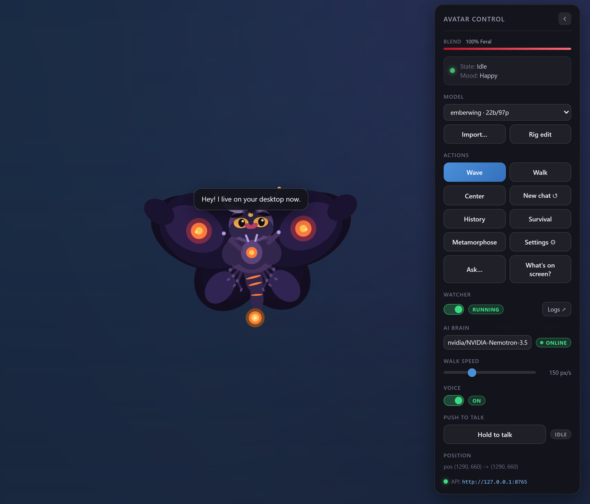

# char-rig — AI desktop avatar

A 2D character that lives on your Windows desktop. It walks around a transparent
always-on-top overlay, blinks, emotes, talks with a speech bubble — and exposes a
local HTTP API so an AI agent can drive it.



* Rust + Tauri 2 (WebView2) shell, canvas renderer, axum HTTP API
* Data-driven rigs (`model.json`), editable in-app, with sprite parts + variants
* Custom keyframe animations: author clips in the rig editor, play them from the UI, the HTTP API or an MCP agent
* Works alongside your desktop: only the titlebar, panel and avatar catch clicks

---

## Quick start

Requirements: **Rust** (1.77+ toolchain), **WebView2 runtime** (ships with
Windows 11), Windows 10/11.

```bash
cd src-tauri
cargo build
./target/debug/avatar-desktop.exe
```

`cargo build` produces **three** binaries in `src-tauri/target/debug/`:
`avatar-desktop.exe` (the app), `char-rig-mcp.exe` (the MCP bridge — see
[Hermes / MCP](#hermes--mcp)) and `char-rig-watcher.exe` (the trigger watcher —
see [Waking Hermes](#waking-hermes-the-watcher)).

The console prints `avatar api listening on http://127.0.0.1:8765`. The avatar
appears at the centre of the primary monitor; empty desktop space is
click-through.

**The watcher comes with it.** Once the API is bound, `avatar-desktop.exe` starts
`char-rig-watcher.exe` from its own directory, pointed at the URL it just bound
(`--api-url http://127.0.0.1:8765`) and at a `watcher_rules.json` it finds beside
the binaries or up to three directories above (the repo root in a checkout), with
no console window of its own and its stderr inherited so its log lines land next
to the app's. A supervisor thread
restarts it after a crash (2 s, backing off to 30 s), and closing the avatar —
titlebar **X**, `POST /shutdown`, or an app exit — kills and reaps it, so no
orphaned watcher is ever left behind. Set `CHAR_RIG_NO_WATCHER=1` to opt out and
run the watcher by hand.

Verify it responds:

```bash
curl -s localhost:8765/health
curl -s localhost:8765/context          # foreground window + idle seconds
curl -N localhost:8765/events           # live push stream (Ctrl-C to stop)
curl -s -X POST localhost:8765/speak -H 'content-type: application/json' \
     -d '{"text":"Hello!","expression":"happy","duration_ms":4000}'
```

Run the unit tests with `cd src-tauri && cargo test`.

### Optional environment

| Variable | Default | Meaning |
| --- | --- | --- |
| `CHAR_RIG_API_PORT` | `8765` | API port (next free port used if busy) |
| `CHAR_RIG_MODELS` | `<repo>/models` | model root directory |
| `CHAR_RIG_NO_WATCHER` | *(unset)* | `1`/`true` stops `avatar-desktop` from spawning and supervising `char-rig-watcher.exe` — use it when running the watcher manually in a terminal |
| `WEBVIEW2_ADDITIONAL_BROWSER_ARGUMENTS` | *(unset)* | passed straight to WebView2; set to `--remote-debugging-port=9222` to attach DevTools/CDP to the running page |

### Developer tools

| Script | Purpose |
| --- | --- |
| `python tools/verify_docs.py` | diffs every HTTP route, Tauri command, SSE event type, `/context` key and interaction kind in the markdown against `src-tauri/src/*.rs` and `ui/js/*.js`; exits non-zero on drift |
| `node tools/cdp-eval.mjs <wsUrl> <expr>` | evaluates an expression inside the running page (see the row above for the port); used to drive `window.__avatarDebug` without a mouse — e.g. `node tools/cdp-eval.mjs ws://127.0.0.1:9222/devtools/page/<id> 'window.__avatarDebug.interaction("click", 400, 300)'` |
| `python tools/mcp_smoke_test.py` | drives `char-rig-mcp.exe` over stdio exactly like an MCP client: tool schemas, JSON-RPC error codes, and both the "avatar down" and "avatar up" tool paths (animations included) |

---

## Using it

| Titlebar | |
| --- | --- |
| 🛠 wrench | toggle **Rig Edit Mode** (`R`) |
| ↖ cursor | toggle click-through on empty space |
| — | minimize |
| ✕ | close (stops the API too) |

| Control panel | |
| --- | --- |
| Model dropdown + **Import…** | switch models, import a rig or an image |
| Expression buttons | neutral / happy / sad / surprised |
| Wave / Idle / Walk / Center | triggers, with a walk-speed slider |
| **New chat** | wipe the conversation context (`POST /session/reset`) |
| **Ask…** | open the command bar (same as `Enter` / `/`) |
| **Watcher** switch + badge + **Logs ↗** | start/stop `char-rig-watcher.exe` and open the pop-out console (see [Waking Hermes](#waking-hermes-the-watcher)) |
| API line | live API URL |

**Importing:** pick a `.json`/`.toml` rig, or an image (`.png`, `.jpg`,
`.jpeg`, `.webp`, `.svg`) — images can become a **new character** or be
**attached as a part** to the current rig.

**Building in the editor:** in Rig Edit Mode drag joints to move, drag the ring
at the bone tip to rotate (free multi-turn), shift+wheel to scale. `Add content`
creates new parts/limbs with a semantic tag (`head`, `eye`, `mouth`, `arm_left`,
…); bind sprites to expressions with **Bind PNG**; **Save rig** writes
`models/<name>/rig.json`, **Reset** drops it.

**Animating:** the timeline bar at the bottom of Rig Edit Mode edits named
keyframe clips — `+ Clip`, `Del Clip`, `Duration (ms)`, `Loop`, `Play / Stop`,
a `0..100%` scrubber with keyframe ticks, and `+ Keyframe` to capture the pose on
screen at the playhead. Clips are saved by the same **Save rig** and played over
HTTP (`POST /animate`) or by an agent (`avatar_animate`).

Play-mode shortcuts: `1`–`4` expressions · `W` wander · `I` idle · `C` centre ·
`Space` wave · `R` rig mode · `Esc` close.

Clicking or double-clicking the avatar does not make it react on its own — the
page reports the interaction to Rust, which pushes an `interaction` frame on
`GET /events` so your agent can decide what happens (wave back, speak, ignore).

**Talking back:** press `Enter` or `/` (or the chat icon in the titlebar, or
**Ask…** in the control panel, or just click the speech bubble) and a floating
command bar opens under the avatar. Type a prompt or a task, `Enter` sends it,
and the bubble immediately shows **Thinking…** with the `thinking` face while the
model works. Under the input are one-click **chips** (summarise the clipboard,
"what am I looking at", a diagnostic, a network scan…) loaded from
`quick_tasks` in `watcher_rules.json`, and a **↺** button that drops the
conversation context. `Esc` closes the bar. The text becomes a `user_reply` frame
(`notify_reply` / `POST /reply`), the watcher wakes Hermes with your exact words,
and the bubble's box is a published hit region so the input stays clickable while
the rest of the desktop is click-through.

**Moving it:** in play mode, press on the avatar and drag — it follows the
cursor, clamped to the screen, and idle wandering stays paused for 15 s after
you let go (the release is reported as a `drag_end` interaction). Rig Edit Mode
keeps the press for its gizmos, so the two gestures never fight.

---

## Pushing vs polling

`GET /context` answers *what is the user doing* (foreground window title, the
executable that owns it, machine-wide idle seconds, plus the last 15 SSE frames
as a catch-up). `GET /clipboard` reads the last-copied text (2000 chars max).
`GET /events` is a Server-Sent Events stream of *what the avatar did*: `state`,
`speech`, `speech_cleared`, `model`, `rig_saved`, `pose`, `part_patch`,
`interaction`, `user_reply`, `alert`, `session_reset`. An agent can therefore block on the stream
instead of polling `/state`:

```bash
curl -N localhost:8765/events
```

---

## Waking Hermes (the watcher)

`char-rig-watcher.exe` is the third binary built by `cargo build`. It is the
piece that turns the avatar's stream into an agent turn — and it costs **zero
LLM tokens while idle**: with nothing to report it only reads a keep-alive SSE
stream and polls `/context` every 20 s.

You normally do not start it yourself: `avatar-desktop.exe` spawns it at startup
and supervises it (see [Quick start](#quick-start)). The panel's **Watcher** row
has the switch (`running` / `off` / `missing`), and **Logs ↗** opens a pop-out
console with the child's live output — timestamped, 200 lines, plus the rules
path it was started with, **Clear** and **Test ping** (which fires a
`double_click` through SSE → watcher → Hermes → MCP in one click). The same two
things are available over HTTP:

```bash
curl -s localhost:8765/watcher                         # {enabled, running, pid, paths, logs}
curl -s -X POST localhost:8765/watcher -H 'content-type: application/json' \
     -d '{"enabled": false}'                           # stop it, no app restart
```

Run it by hand — with the output in your terminal — by setting
`CHAR_RIG_NO_WATCHER=1` on the app, or just start it directly against a running
avatar:

```bash
cd src-tauri
./target/debug/char-rig-watcher.exe --dry-run        # print triggers, call nothing
./target/debug/char-rig-watcher.exe \
  --hermes-cmd "hermes run {prompt}"                 # wake Hermes on a trigger
```

It subscribes to `GET /events` and polls `GET /context`, and fires only when a
rule matches:

| Trigger | Fires when | Default cooldown |
| --- | --- | --- |
| `interaction` | the avatar is double-clicked or a drag ends (plain `click` only with `--trigger-single-click`) | 15 s |
| `window_title` | the focused window *changes* to a title containing one of `window_keywords` (case-insensitive substring) **or** matching an `app_rules` entry | 300 s |
| `idle_return` | idle seconds drop back below `idle_threshold_secs` after having exceeded it | 300 s |
| `user_reply` | the user types into the speech bubble's quick-reply box (or a client calls `POST /reply`) — **no cooldown**, the user spoke directly | — |
| `alert` | `POST /alert` from an external monitor (Suricata, cron, a build script) | 60 s (`alerts.cooldown_secs`) |

The first `/context` poll is only a baseline: the watcher never fires on the
window it starts with. A trigger then does three things, in order:

1. `POST /emote` an ack — `thinking` by default — so the avatar reacts before
   the agent has finished thinking (`--no-ack-emote` turns this off).
2. `POST` the JSON payload to `--webhook-url`, if set.
3. Spawn `--hermes-cmd` with a one-line prompt carrying `event_type`, `detail`,
   `window_title` and `idle_secs`.

`{prompt}` in the command is substituted; otherwise the prompt is appended as
the last argument. The command line is split on whitespace with `"`/`'` quote
grouping and **no shell** is involved, so the prompt can never be re-read as
shell syntax — use a script if you need pipes or redirection.

Spawning is **single-flight** and headless, because a pile-up of `hermes`
processes is the one failure mode that actually costs money:

* While a dispatch is in flight (a `--hermes-cmd` child still running, or a
  webhook POST still open), further triggers are **skipped** with a
  `[watcher] debug: dispatch already in flight …` line on stderr. One trigger,
  one agent turn — never a queue of them.
* The child is spawned with `stdin` on `/dev/null`, so an interactive prompt
  reads EOF immediately instead of blocking on a keyboard nobody is typing on.
* The prompt ends with a directive telling the agent this is a headless avatar
  trigger: **no** follow-up questions, and it spells out the exact MCP call
  signatures (`mcp__char_rig__avatar_speak(text, expression?, duration_ms?)`,
  `avatar_emote(expression, duration_ms?)` with the six valid expressions,
  `avatar_wave()`, `avatar_animate(name, loop?)`, plus `avatar_get_context()`
  for the focused window / `process_name` / recent events and
  `avatar_get_clipboard()` for the last-copied text) so the very first turn can
  act without a `tool_describe` round-trip. It also tells the model to **chain
  calls** in one turn (an emote or clip *and* a line of speech) and to keep the
  bubble **under 180 characters** so it never overflows the screen. That matters
  most on a local model, where every extra round-trip eats the timeout.
* The wait is wrapped in a timeout (`--hermes-timeout`, default `120` s, also
  `hermes_timeout_secs` in `watcher_rules.json`); a child that outlives it is
  killed and reaped, which also releases the flight permit. The default is
  deliberately generous — a local model usually needs more than a minute to
  finish its turn.

| Flag | Default | Meaning |
| --- | --- | --- |
| `--api-url <URL>` | `$CHAR_RIG_API_URL` or `http://127.0.0.1:8765` | avatar API base |
| `--rules <PATH>` | `./watcher_rules.json`, then next to the exe | rules file (see below) |
| `--context-interval <SECS>` | `20` | how often `GET /context` is polled |
| `--trigger-single-click` | off | also fire on plain `click` interactions |
| `--ack-emote <EXPR>` | `thinking` | expression shown the moment a trigger fires |
| `--no-ack-emote` | — | disable the ack emote entirely |
| `--hermes-cmd <CMD>` | `$CHAR_RIG_HERMES_CMD` | command spawned with the prompt |
| `--hermes-timeout <SECS>` | `120` | kill a spawned `--hermes-cmd` after this long |
| `--webhook-url <URL>` | *(none)* | `POST` the trigger payload here |
| `--dry-run` | off | print payloads on stdout and call nothing |

Precedence is **CLI flag → environment → `watcher_rules.json` → built-in
default** (`hermes_timeout_secs` follows the same order, minus an env var). If
the avatar is not running (or restarts), the watcher reconnects with exponential
backoff from 1 s up to 30 s; a failing context poll logs once and keeps trying.
Diagnostics go to stderr; stdout carries only `--dry-run` payloads, so it stays
pipe-friendly.

`watcher_rules.json` (repo root) tunes the rules; a missing or invalid file
falls back to the built-in defaults shown here:

```json
{
  "interactions": {
    "double_click": true,
    "drag_end": true,
    "click": false,
    "cooldown_secs": 15
  },
  "context": {
    "window_keywords": ["error", "failed", "exception"],
    "idle_threshold_secs": 900,
    "cooldown_secs": 300
  },
  "app_rules": [
    {
      "process": "Code.exe",
      "title_contains": "error",
      "animation": "surprised",
      "prompt_hint": "This is a compile/build error in the user's editor."
    }
  ],
  "alerts": { "enabled": true, "cooldown_secs": 60 },
  "quick_tasks": [
    { "label": "Summarize clipboard", "prompt": "Call avatar_get_clipboard and summarise what I copied." },
    { "label": "Scan the network", "prompt": "Read the Suricata fast.log and report anything new." }
  ],
  "max_session_turns": 15,
  "session_idle_reset_secs": 1800,
  "session_base": "char-rig",
  "ack_emote": "thinking",
  "hermes_cmd": "hermes chat --continue {session} --create-if-missing -Q -q",
  "hermes_timeout_secs": 120,
  "webhook_url": null
}
```

`app_rules` entries match the focused window on `process` (`/context`'s
`process_name`, e.g. `Code.exe`) and `title_contains` — both case-insensitive
substrings, blank = wildcard, first match wins. A match supplies the ack
`animation` (an expression name emotes, anything else is played as a keyframe
clip) and a `prompt_hint` that is appended to the Hermes prompt as `Context: …`.
`alerts` throttles `POST /alert` frames from outside (network monitor, cron).

`quick_tasks` is the command bar's chips (`[{label, prompt}]`, at most 6) — edit
the file, reopen the bar, and the buttons change, no rebuild. `max_session_turns`
and `session_idle_reset_secs` rotate the conversation automatically (after N
turns / after a long break), and `session_base` is the id prefix.

The shipped `hermes_cmd` keeps one conversation across triggers and is
**rotatable**: `hermes chat --continue {session} --create-if-missing -Q -q`.
`{session}` becomes the watcher's current id (`char-rig-<epoch>`, then `-2`,
`-3`… after each **New chat**/auto-rotation), `-Q` keeps its banner out of the
watcher's log, and `-q` must stay **last** because the prompt is appended as the
final argv entry. Per-run overrides such as `--run-budget`, `--model` or `-t`
are rejected on a resumed session — put them in `config.yaml` instead.

---

## Hermes / MCP

`cargo build` also produces a second binary, **`char-rig-mcp.exe`** — a stdio MCP
server that exposes the avatar to Hermes (or any MCP client) as eleven tools:
`avatar_speak`, `avatar_emote`, `avatar_move`, `avatar_wave`, `avatar_pose`,
`avatar_get_context`, `avatar_get_clipboard`, `avatar_list_models`,
`avatar_switch_model`, `avatar_list_animations`, `avatar_animate`.
`avatar_get_context` carries the window title, the owning `process_name`, idle
seconds and the last 15 events; `avatar_get_clipboard` returns the last-copied
text (2000 chars max).

It is a stateless bridge: each tool call is one HTTP request to the running
`avatar-desktop.exe`, so **start the avatar first**. If it is not running, the
tool returns a readable `isError` result (with a hint) instead of breaking the
session.

Add this to Hermes' `config.yaml` (Windows paths use forward slashes or a
single-quoted literal; both work):

```yaml
mcp_servers:
  char-rig:
    command: 'C:\hermes\char-rig\src-tauri\target\debug\char-rig-mcp.exe'
    args: []
    env:
      CHAR_RIG_API_URL: http://127.0.0.1:8765
```

Then restart Hermes (or reconnect the server) — the eleven `avatar_*` tools show
up in the tool list. Verify the bridge on its own with:

```bash
python tools/mcp_smoke_test.py
```

which drives the real stdio protocol and asserts the tool schemas, the error
path when the avatar is down, and every tool against a live avatar.

---

## Documentation

| File | Contents |
| --- | --- |
| **[ARCHITECTURE.md](ARCHITECTURE.md)** | System design, threading model, codebase map, rig schema, full API reference, limitations & roadmap |
| [API.md](API.md) | Endpoint reference with payloads and `curl` examples |
| [MODEL_FORMAT.md](MODEL_FORMAT.md) | Model folder layout, manifest schema, editor guide |

---

## Project layout

```
src-tauri/            Rust application (Tauri 2)
  src/lib.rs          windows, state, commands, event bus (SSE), desktop probes, click-through tracker, startup
  src/api.rs          axum HTTP API (own thread + Tokio runtime)
  src/models.rs       model/rig storage, validation, import pipeline
  src/bin/
    char-rig-mcp.rs   second binary: stdio MCP server exposing the avatar_* tools over HTTP
    char-rig-watcher.rs  third binary: SSE + /context watcher that wakes Hermes on triggers
  tauri.conf.json     transparent always-on-top window, frontendDist = ../ui
ui/                   modular frontend (native ES modules, no build step)
  index.html          lean HTML shell (titlebar, canvas, panels, bubble, toasts)
  styles.css          all CSS rules
  js/
    ipc.js            Tauri access (call/listen/isTauri), read lazily from window.__TAURI__
    state.js          shared state & constants (avatar, RT, speech, viewport, EXPRESSIONS)
    rig.js            model ingestion, skeletal FK (incl. clip offsets), part geometry, hit regions, serialization
    animator.js       custom keyframe clips: sampling, playback, authoring, finished state
    renderer.js       canvas rendering pipeline
    editor.js         rig editor gizmos, inspector, bone/part authoring, undo
    speech.js         speech bubble lifecycle + quick-reply box
    bridge.js         Tauri events, state reports, import flow, click-through
    main.js           entry point: DOM bindings, shortcuts, __avatarDebug, main loop, click detection
models/               rigs + sprites (+ .state.json remembering the selection)
watcher_rules.json    optional trigger rules for char-rig-watcher.exe (built-in defaults when absent)
docs/                 screenshots
tools/                verify_docs.py (docs↔source diff), cdp-eval.mjs (evaluate JS in the running page)
```

`ai-avatar-bridge/`, `avatar-editor/`, `avatar-desktop/` and `spikes/` are
earlier prototypes kept for reference; they are **not** part of the running app
and can be deleted.

## Status

Prototype / hobby project. Windows-only click-through and desktop context,
single monitor, unauthenticated localhost API. Live events over SSE; polling
`/state` still works and is still the simplest read path. See *Known
limitations* in [ARCHITECTURE.md](ARCHITECTURE.md) before depending on it.
