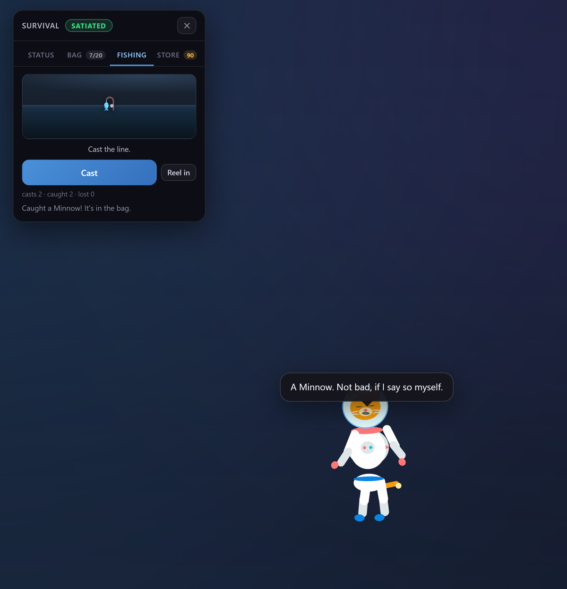
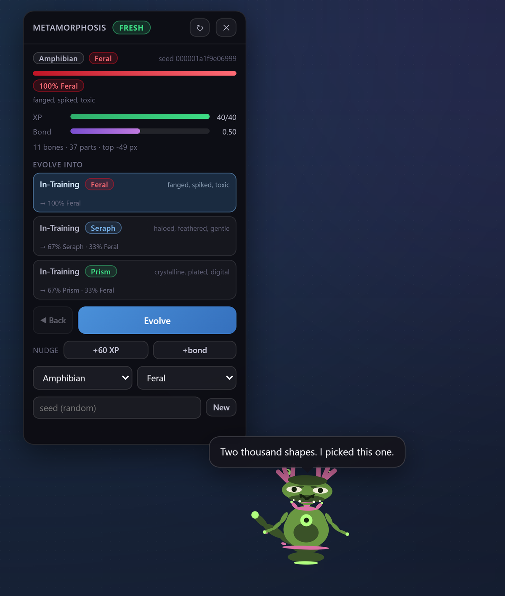
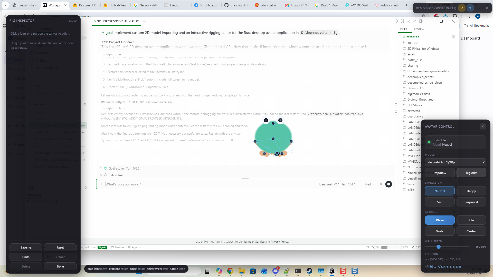
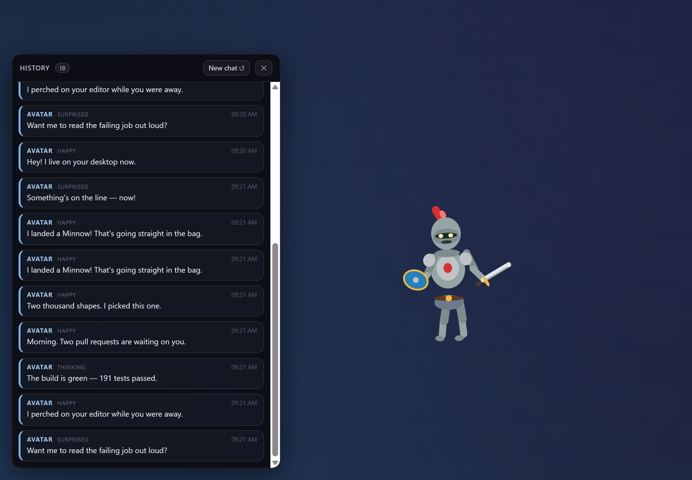

# Desktop Buddy

### *Your own little computer gremlin*

[](LICENSE)
[](https://github.com/dunkzinski/desktop-buddy/actions/workflows/check.yml)
[](src-tauri/Cargo.toml)
[](#cross-platform-support)

Somewhere between a desktop toy and a daemon lives a small creature that sits on your screen. It perches on the edge of whatever window you're using, tracks your cursor with its pupils, notices when the build fails, says something unhelpful about it out loud, and occasionally sulks until you take it fishing.

It is also **a local-first desktop companion runtime built in Rust + Tauri 2**, and the joke is the only part that isn't engineered. The overlay is a real click-through window spanning your virtual desktop. It renders skeletal 2D rigs. It speaks through local Piper TTS and lip-syncs to the measured RMS envelope of the audio it just generated. It listens through Silero VAD + `whisper.cpp`. It reads which window has focus and which process owns it, grabs screenshots in memory when you ask what you're looking at, and hands all of it to a local model or an agent — while exposing a 64-route HTTP/SSE API and a 14-tool MCP bridge so you can drive *it* right back.

Zero cloud keys required. Zero idle tokens burned. Zero excuses for the fishing mini-game.

## What it's made of

* **Native Rust core:** Tauri 2 (WebView2) shell, native ES-module canvas renderer, and an `axum` HTTP/SSE API on its own Tokio thread.
* **Data-driven 2D skeletal rigs (`model.json`):** Bones, sprites, expression bindings and keyframe clips — authored in-app, then triggered via UI, HTTP, or MCP.
* **Real-time life signs:** Mouth shapes track actual Piper WAV RMS energy (falling back to phoneme-mapped typing when muted), pupils track the OS cursor across monitors, and `POST /perch` dynamically tracks target window borders as you drag or resize them.
* **Fully local voice & vision:** Local Piper TTS (`rodio`/`cpal`), push-to-talk via Silero VAD + `whisper.cpp`, and in-memory screen capture routed to local vision-language models. No cloud keys required.
* **Sandboxed WebAssembly plugins:** Fuel-metered `wasm32-unknown-unknown` guests with isolated linear memory — shipping with a survival/fishing/scavenging economy loop and a deterministic procedural creature generator (`2,160` base silhouettes across 15 body plans).
* **Zero-idle-token watcher:** A supervised background daemon subscribes to SSE and polls window context, waking an agent or local model only when rules match.

## Screenshots


The two Wasm plugin surfaces, side by side:

 

 

---

## Quick start

**Requirements:** **Rust** (`1.85+`, per `rust-version` in `src-tauri/Cargo.toml`), the **`wasm32-unknown-unknown`** target for the plugins (`rustup target add wasm32-unknown-unknown`), and **WebView2** (ships with Windows 11). Local voice I/O optionally uses **Piper** and **whisper.cpp**—without them, the app runs fine silently.

### Automated install (AI-agent-friendly)

```powershell
# Windows (PowerShell 5.1+): prerequisites, build, Hermes wiring, bridge proof
iwr https://raw.githubusercontent.com/dunkzinski/desktop-buddy/main/install.ps1 -UseBasicParsing | iex
```

```bash
./install.sh     # Linux / WSL / git-bash: build only (Windows is the supported desktop)
```

Windows is the supported platform. `install.ps1` needs no bash, never hand-edits
`config.yaml` (it drives `hermes mcp add`), and finishes by speaking JSON-RPC to
`desktop-buddy-mcp.exe` rather than trusting `hermes mcp test`, which can pass
while the gateway is still holding a dead child. See **[INSTALL.md](INSTALL.md)**
for the flags, what each verification step actually proves, and troubleshooting.

> The one-liner reads the script from `main`, so it only resolves once that file
> is on the default branch — a fork or a feature branch needs a local run.

### Manual quick start

```bash
./scripts/build-plugin.sh     # plugins are .wasm artifacts and gitignored — a fresh clone has none
cd src-tauri
cargo build
./target/debug/desktop-buddy.exe
```

`cargo build` produces **three** binaries in `src-tauri/target/debug/`:
1. `desktop-buddy.exe` — the overlay, canvas renderer, Wasm plugin host, and `axum` server (`http://127.0.0.1:8765`).
2. `desktop-buddy-watcher.exe` — the trigger daemon. `desktop-buddy.exe` spawns and supervises it automatically (set `DESKTOP_BUDDY_NO_WATCHER=1` to run it manually).
3. `desktop-buddy-mcp.exe` — the stdio MCP bridge exposing 14 `avatar_*` tools to Hermes or any MCP client.

Poke the gremlin to make sure it's alive:

```bash
curl -s localhost:8765/health
curl -s localhost:8765/context          # focused window, rect, visible windows, idle seconds
curl -N localhost:8765/events           # live SSE push stream
curl -s localhost:8765/history          # bounded chat history (50 turns)
curl -s -X POST localhost:8765/speak -H 'content-type: application/json' \
     -d '{"text":"Hello!","expression":"happy","duration_ms":4000}'
curl -s -X POST localhost:8765/perch -H 'content-type: application/json' \
     -d '{"edge":"top_right","window_process":"Code.exe"}'
```

---

## Meet your gremlin

The creature is put together from four entirely sensible subsystems wearing one very small hat.

| What you see | What is actually happening |
| --- | --- |
| It blinks, breathes, and flaps its mouth while talking | `ui/` drives a skeletal rig from `model.json`; mouth shapes follow the RMS envelope of the WAV Piper just produced |
| It watches your cursor | Pupils track the OS cursor across every monitor, with a deadband and emit interval in `lib.rs` so gaze doesn't chatter |
| It stands on the corner of your editor | `POST /perch` — the avatar follows that window's border as you drag or resize it |
| It says "that's a compile error, by the way" | The watcher matched a window title, ran exactly one AI turn, and spoke the reply through local TTS |
| It stares at your screen for a second | Screen vision: active window captured in memory, downscaled, JPEG-encoded, sent to a local VLM. Nothing touches disk |

### It watches — politely

A supervised `desktop-buddy-watcher.exe` polls `GET /context` (every 20 s by default, `--context-interval`) and receives the focused window's **title**, the **process name** that owns it, **seconds since you last touched the keyboard or mouse**, and the front five `visible_windows` — which is what `POST /perch` can target by process. That's the whole observation surface: it is not recording your screen, it is reading the caption bar and the idle clock.

Add keywords to `context.window_keywords` (`error`, `failed`, `exception` — whatever you consider a cry for help) and it reacts when you switch *to* such a window: once, with a cooldown, and only when the title actually changes, so a live window can't machine-gun the model.

Rules live in `watcher_rules.json`, read fresh on every turn: pointer gestures on the avatar (`interactions`), per-app overrides (`app_rules` — match `Code.exe` plus `title_contains: "error"`, give it its own ack animation and a faster `profile`), returning from idle (`idle_return`), external webhooks (`POST /alert`), and plugin events (`fish_caught`, `creature`, …).

### It talks

* **Speech output:** Every speech bubble is sanitized and synthesized on a dedicated `avatar-tts` thread via Piper, streaming 25 ms RMS amplitude buckets to the renderer for audio-driven lip-sync. No Piper, no problem — it falls back to phoneme-mapped typing motion and stays quiet.
* **Push-to-talk (`Alt+V`):** Hold to capture mic audio via `cpal`, filter with Silero VAD, and transcribe locally via `whisper-cli`. Starting a hold immediately interrupts active TTS playback, so the mic never transcribes the gremlin's own voice.
* **Keyboard:** `Alt+Space` summons the command bar (with your `quick_tasks` chips), `H` opens the bounded 50-turn history drawer, `R` opens the rig editor.

### It looks at your screen — when asked

Press **What's on screen?**, or say/type *"what's on my screen?"*, to grab the active window in memory, downscale and JPEG-encode it, and send it to any `openai_compat` vision profile (e.g. `llama.cpp` with a small VLM). `vision.max_image_dim` (default `1024`), `vision.jpeg_quality` (`85`), and `vision.capture_mode` (`active_window` or `full_screen`) live in `watcher_rules.json`; `vision.trigger_phrases` decides which sentences count as a request.

### It doesn't eat your RAM

No browser is bundled — the overlay is a Tauri window on the WebView2 runtime the OS already ships. Everything that could grow is bounded on purpose:

* the idle cost is one context poll every 20 s and **zero** tokens; nothing dispatches unless a rule fires, and routine window noise is dropped rather than queued;
* dispatch is single-flight with a one-slot priority queue, so a chatty window can't pile up turns;
* history is capped at 50 turns, plugin messages at 4 MiB, plugin state files at 1 MiB, plugin CPU at 50 M instructions per call, and each guest ticks once a second;
* debug builds optimise dependencies only (`[profile.dev.package."*"]`, `opt-level = 2`), which is why a cold start isn't ten seconds of Cranelift.

---

## Build a gremlin

The rig format is the whole point: **anything with bones, sprites and clips is a gremlin.** There are 15 hand-authored rigs in `models/` to start from — and a full editor for the one you actually want.

### Rig Edit Mode (`R`)

Open it from the titlebar wrench, the **Rig edit** button, or the `R` key. The animation freezes, the avatar parks itself mid-screen, and you get an inspector on the left, a bone overlay on the creature, and a keyframe timeline along the bottom.

| You do this | It does that |
| --- | --- |
| drag a joint | moves that bone (`pos`) |
| drag the ring at a bone tip | rotates the bone, clamped by its `limits` |
| drag a part | changes the part's `offset` — or moves its bone when the part is locked |
| `Shift+Wheel` on a part | scales the sprite |
| `Ctrl+Z` / **Undo** | steps back through 80 levels of edits |
| **+ Bone** | adds a capsule child of the selection (or of `root`, or the root itself) |
| **Lock Bone to Part** | welds sprite to bone, so artwork and pivot travel together |
| **Snap Bone to Part** | moves the bone origin onto the sprite and zeroes the offset |

Bones can be re-parented from the dropdown (cycles rejected) and deleted with their descendants, and every inspector field accepts typed numbers as well as wheel-scrubbing.

### Keyframes without a DCC tool

The timeline edits the rig's `animations`, persisted by the same **Save rig**:

1. `+ Clip` — a new empty clip (`duration_ms: 1200`, `loop: false`), selected and parked at 0 %.
2. `+ Keyframe` — captures every bone's current delta, so the clip starts from the rest pose.
3. Scrub the 0–100 % playhead, drag the arm where you want it, `+ Keyframe` again at 40 % and 100 %.
4. **Play** to preview in place, **Save rig** to write `models/<name>/rig.json` — atomically (write + rename), after validating the hierarchy and every referenced image.

While a clip is selected, drags edit the *clip pose*, not the bind pose, so practising a wave never deforms your character. A pose you haven't captured shows as `unsaved` and is discarded when the playhead moves; keyframe capture is deliberately outside the `Ctrl+Z` bone history.

### Sprites, shapes and imports

* Drop in a `.png`, `.svg` or `.webp` as a new character, or attach it as a limb to an existing rig. Images over 16 MB — or paths that escape the model folder — are rejected with a readable message instead of a stack trace.
* Prefer no artwork at all? Parts can be **shapes** with procedural expression channels, so a silhouette-only gremlin still blinks, squints and talks.
* Mouth shapes, blinks and expression bindings are all manifest fields; `MODEL_FORMAT.md` covers the schema, the draw-order conventions and the silhouettes that still read at 32 px.

Save a rig and it hot-swaps in place via `POST /model` — no rebuild, no restart. Broken folders surface as `name (broken)` in the picker rather than taking the whole model list down with them.

---

## Give your gremlin a brain

Out of the box the gremlin is a beautifully animated empty vessel. Point it at a model.

### Two kinds of brain, one dropdown

**Settings ⚙ → AI brain** switches profiles live, and **Discover** probes `discovery_ports` / `discovery_hosts` (defaults include `11434` for Ollama and `1234` for LM Studio, plus any LAN hosts you name) and offers whatever answered.

```json
{
  "active_profile": "hermes",
  "ai_profiles": {
    "local-fast": {
      "kind": "openai_compat",
      "label": "llama.cpp · lfm3-1.7b",
      "endpoint": "http://127.0.0.1:8080/v1",
      "model": "lfm3-1.7b",
      "max_tokens": 512,
      "timeout_secs": 60,
      "system_prompt": "You are a tiny, fast desktop avatar assistant…"
    },
    "hermes": {
      "kind": "hermes_cli",
      "label": "Hermes CLI",
      "cmd": "hermes chat --continue {session} --create-if-missing -Q -q",
      "timeout_secs": 120
    }
  }
}
```

| Kind | Good at | Tools |
| --- | --- | --- |
| `openai_compat` | anything speaking `/v1/chat/completions` — `llama.cpp`, Ollama, LM Studio, or a hosted endpoint (`api_key` is sent as `Authorization: Bearer …`) | none; it acts through its reply JSON (`speech`, `expression`, `animate`, `wave`, `escalate`) |
| `hermes_cli` | a real agent turn, headless | the full MCP toolset of the agent you configure |

An `openai_compat` profile can raise a hand: reply `{"escalate": true}` and the same turn re-runs on a `hermes_cli` profile. That's the whole routing story — **cheap and instant by default, a real agent when the question deserves one.** At least one `hermes_cli` profile is required for exactly this reason (and so **New chat** has somewhere to go).

### Whoever answers, it's wake-on-demand

The watcher owns dispatch. Every trigger carries an `event_type` — `interaction`, `window_title`, `idle_return`, `user_reply`, `alert`, `fish_caught`, `fish_lost`, plus plugin frames — gets an ack emote, optionally a `webhook_url` POST, and then exactly one AI turn. One dispatch in flight at a time: a `user_reply` or `alert` arriving mid-turn waits in a one-slot queue (newest wins), while routine window noise is dropped rather than queued. When nothing fires, nothing is spent.

### The personality is a markdown file

`SOUL.md` defines the gremlin's voice — who it is, how it talks, what it refuses to do — and is re-read live on every turn, injected as the first system-message slot. It is deliberately *not* config: no paths, no profiles, no secrets, no tools. Personalities are therefore reviewable, diffable and shareable, which is the nicest thing you can say about a personality.

It sits beside `watcher_rules.json` by default (`soul_path` or `$DESKTOP_BUDDY_SOUL` override it), and the control panel's SOUL tab edits whatever it resolves to.

### MCP: it gets tools, and it *is* one

There are two directions here and both are real.

**1. It inherits your tools.** The `hermes_cli` profile runs an actual agent turn, so the MCP servers you already registered (filesystem, GitHub, a home IDS, whatever) are available to the gremlin mid-sentence. No extra wiring.

**2. It exposes itself as tools.** `desktop-buddy-mcp.exe` is a stdio MCP server with 19 `avatar_*` tools, so any MCP client can make the creature look at something, say something, hop onto a window, read the session's history or check on the creature it is wearing. Register it in your Hermes `config.yaml`:

```yaml
mcp_servers:
  desktop-buddy:
    command: 'C:\hermes\desktop-buddy\src-tauri\target\debug\desktop-buddy-mcp.exe'
    args: []
    env:
      DESKTOP_BUDDY_API_URL: http://127.0.0.1:8765
```

The tools: `avatar_speak`, `avatar_emote`, `avatar_move`, `avatar_perch`, `avatar_wave`, `avatar_pose`, `avatar_animate`, `avatar_get_context`, `avatar_get_history`, `avatar_get_creature`, `avatar_get_clipboard`, `avatar_set_clipboard`, `avatar_list_models`, `avatar_switch_model`, `avatar_list_animations`, `avatar_switch_ai`, `avatar_send_alert`, `avatar_clear_speech`, and `avatar_clear_pose`.

Every one is a thin, honest wrapper over the HTTP API (`GET /context` + `GET /state`, `POST /pose`, `POST /clipboard`, `GET /history`, `POST /alert`, and friends) — which means if an MCP tool can do it, `curl` can do it too. The one exception is deliberate: `avatar_get_creature` needs the metamorphosis plugin, and without it the call comes back as an `avatar_route_unavailable` error naming the guest to build rather than a mysterious 404.

---

## Teach your gremlin new tricks with WASM plugins

Everything that isn't the avatar engine itself is a plugin: hunger, fishing, scavenging, the entire procedural creature generator, and whatever you build next. Guests are standalone `wasm32-unknown-unknown` crates loaded from disk at startup, so adding a trick never means recompiling the host.

```bash
./scripts/build-plugin.sh              # every plugin
./scripts/build-plugin.sh survival     # just one
cd src-tauri && cargo build            # only if the host itself changed
```

The host looks in `$DESKTOP_BUDDY_PLUGINS_DIR`, then `./plugins`, then `plugins/` beside the executable, then `plugins/` at the repo root — first existing directory wins, every `*.wasm` in it is loaded sorted by file name, and that is also the `init` / `tick` / `shutdown` order. A guest's HTTP routes are merged into the same `axum` router as the core API (watch for `merged N plugin route(s)` in the log), so a plugin can add endpoints that behave exactly like `/health`.

### The ABI: JSON in, JSON out

The host calls these exports. Each `plugin_*` reply packs `(ptr << 32) | len`, and `0` means "no result":

| Export | Signature | Purpose |
| --- | --- | --- |
| `alloc` / `dealloc` | `(len) -> ptr` / `(ptr, len)` | the host writes its request into guest memory |
| `plugin_init` | `(ptr, len) -> i64` | `{"config", "state", "state_path"}` |
| `plugin_tick` | `(dt_ms: i64) -> i64` | one tick; `null` on success |
| `plugin_status` | `() -> i64` | the guest's own status object |
| `plugin_routes` | `() -> i64` | `[{"path", "methods"}]` |
| `plugin_http` | `(ptr, len) -> i64` | `{"method", "path", "body"}` → `{"status", "body"}` |
| `plugin_config` | `() -> i64` | which `watcher_rules.json` block is yours |
| `plugin_config_validate` / `plugin_config_apply` / `plugin_config_warnings` | `(ptr, len) -> i64` | validate a patch, adopt it live, report stray keys |

And this is the *entire* capability surface handed to a guest — all nine host imports:

| Import | What it gets you |
| --- | --- |
| `host_emit_event` | publish on the SSE bus **and** to the page |
| `host_notify` | speak a bubble with a known expression |
| `host_now_ms` | the host clock — a guest has no clock of its own |
| `host_log` | levelled logging into the app log |
| `host_state_save` | persist JSON beside the `.wasm` (1 MiB cap) |
| `host_ai_attached` | is a brain subscribed? (so the pet can react on its own when nobody's listening) |
| `host_model_write` | write a validated `models/<slug>/model.json` |
| `host_model_activate` | hot-swap the avatar — `POST /model`'s code path |
| `host_animate` | play a clip by name — `POST /animate`'s code path |

No filesystem, no network, no environment, no reaching into the app's internals. If it isn't in that table, it doesn't exist.

### The sandbox is the feature

| Limit | Value |
| --- | --- |
| Instructions per guest call | `50,000,000` (`FUEL_PER_CALL`) |
| Largest request/response body | 4 MiB (`MAX_MESSAGE_BYTES`) |
| Largest state file | 1 MiB (`MAX_STATE_BYTES`) |
| Tick period / longest tick delta | 1 s / 900 s |
| Consecutive tick errors before parking | 3 |
| Memory | one `Store` per guest — linear memory, fuel and failure are all per-plugin |

Fuel is metered per call (`Config::consume_fuel(true)` starts a store with **zero** fuel, so the host seeds and resets it around every call and every `dealloc`). Bounds-checking is wasmtime's; the host only copies through the exported area and rejects out-of-range pointers instead of panicking. A guest `panic = "abort"` becomes a trap: the registry counts it, parks the plugin after three consecutive tick failures, and still runs its `shutdown` hook. A `.wasm` that won't compile or instantiate is logged and skipped — **a bad drop-in cannot stop the app from starting.**

### What already ships

* **`survival.wasm`** — hunger/saturation metabolism, a 20-slot stack-aware bag, 24 foods, 6 recipes, a 13-item shop (`GET /store`, `POST /store/buy`, `POST /store/sell`), a four-phase fishing mini-game, and **scavenging** (`GET /scavenge`, `POST /scavenge/start`): a 10–30 s walk around your open windows that needs no rod, bait, coins or food and always pays, so running out of everything is recoverable instead of a dead end. Body events route to the AI brain with quiet offline fallbacks: with no brain attached, the gremlin reacts on its own instead of monologuing into the void.
* **`metamorphosis.wasm`** — a pure-Rust procedural character generator (`Fresh → Mega`). One seed drives 15 archetypes × 6 forms × 4 builds = 360 structural silhouettes, each paired with a marking derived from `(build + form) mod 6` — **2,160 base combinations** before the seed's own deformation layer. It synthesizes complete `desktop-buddy/model@1` skeletons with exact kinematic mirroring (`atan2(sin θ, −cos θ)`) and hot-swaps them onto the desktop via `host_model_write` + `host_model_activate`. Bodies are pinned in the save, so rewinding a stage restores that exact creature.

### Writing one

A guest is a plain `cdylib` + `rlib` with its own workspace:

```toml
[workspace]

[lib]
crate-type = ["cdylib", "rlib"]   # cdylib = the .wasm, rlib keeps cargo test working

[profile.release]
opt-level = "s"
lto = true
codegen-units = 1
panic = "abort"
strip = true
```

Declare the nine imports as `extern "C"` on `wasm32` and as a **recording stub** everywhere else — that's what lets `cd plugins/my-gremlin && cargo test --lib` run natively, with no wasm runtime in the loop. Then `./scripts/build-plugin.sh my-gremlin`, restart the app, and it's live: the host loads the artifact, never the source tree.

Two traps worth knowing up front. `plugin_config` must answer on a **cold** instance (the host needs your config key before it calls `init`). And never call back into the plugin registry from inside a call — `plugins::status()` takes the mutex the ticker already holds, which is a deadlock, not a warning.

**[PLUGINS.md](PLUGINS.md)** has the full ABI, the config bridge, lifecycle, registry states, and the economy tables.

---

## Let your gremlin evolve

### Roadmap, honestly

* **Packaging that behaves like software.** A data-directory split so the app stops writing next to its own `.exe`, a real installer (WiX/NSIS, with the two guests as optional components), code signing, and auto-update. The portable zip is deliberate, not finished.
* **Platform parity.** Audio I/O, hotkeys, clipboard and active-window tracking already work on Linux/X11 and macOS through `src-tauri/src/platform/`; screen capture is Windows-only today and Wayland runs in partial mode. `tools/platform-check` at least keeps the compilation honest.
* **DPI sanity.** Mixed per-monitor scaling across a multi-monitor virtual desktop remains the main rough edge, and it is a genuinely unpleasant one.
* **A sharper sense of context.** The watcher can poll window context and hand over a screenshot on request; richer, opt-in observation is the obvious next step.
* **Swappable TTS engines.** Piper is what ships and its RMS envelope is what drives lip-sync today. A Kokoro (or any other WAV-emitting) backend behind the same tap is a wanted patch, not a shipped feature.
* **A plugin registry.** Two guests prove the ABI; a place to find, install and sandbox other people's gremlins is the natural follow-up.

### Contributing

Issues and PRs welcome — this is an active hobby build, so the bar is "it works and it's honest", not "it's a startup".

Before you open a PR, run the same gates CI runs:

```bash
cd src-tauri
cargo test --lib --bins                       # 270 + 12 + 138 tests
cd ../plugins/survival  && cargo test --lib   # each guest is its own workspace
cd ../metamorphosis     && cargo test --lib
cd ../..                                      # back to the repo root
node --test tools/entity-transform.test.mjs   # ui/js geometry
python tools/verify_docs.py
```

`verify_docs.py` is the one to respect: it parses the Rust source for routes, events, watcher flags and MCP tool names, then fails if `README.md`, `API.md`, `ARCHITECTURE.md` or `CONFIGURATION.md` disagree with it. Touch a route, a flag, or an `AVATAR_EXPRESSIONS` entry, and the documentation becomes part of your change. That's the point.

`tools/entity-transform.test.mjs` is the same idea pointed at the frontend: `cargo` cannot see `ui/js`, so the prop transforms (attachment resolution, the `attach.flip` mirror, per-rig fitting) are tested in node against the real ES modules.

Things someone could build tomorrow with what's already here: a gremlin that reacts to CI failures via `POST /alert`; a plugin owning an IRC or chat bridge; a rig pack of punctuation-only blob creatures; a `Code.exe` rule that answers a compile error with one very specific animation you authored at 3 a.m.

---

## Cross-platform support

OS calls are isolated behind `src-tauri/src/platform/`:

* **Windows:** Full feature set (Win32 click-through, DWM focus, GDI `BitBlt` screen capture, global hotkeys, WASAPI audio).
* **Linux (X11) & macOS:** Audio I/O (`rodio`/`cpal`), global hotkeys, clipboard, and active-window tracking (`xdotool`/`wmctrl` and `osascript`) work out of the box. Wayland runs in partial mode (no portable focused-window title API), and screen capture currently requires Windows.

Verify cross-platform compilation without a full Tauri GUI toolchain:

```bash
cd tools/platform-check && cargo check --target x86_64-unknown-linux-gnu
```

---

## Project layout

```text
src-tauri/
  src/
    lib.rs               Tauri windows, state, SSE event bus, click-through tracker
    api.rs               axum HTTP/SSE server
    models.rs            Rig storage, validation, image/rig import pipeline
    tts.rs / stt.rs      Local Piper TTS & Whisper + Silero VAD push-to-talk
    settings.rs          Byte-span JSON config editor (GET/POST /config)
    platform/            OS abstraction layer (win32.rs, unix.rs)
    plugins/             Wasmtime/Wasm sandbox host & route proxy
  src/bin/
    desktop-buddy-mcp.rs      Stdio MCP server binary
    desktop-buddy-watcher.rs  SSE + context trigger daemon binary
plugins/                 Guest Wasm crates (survival, metamorphosis) + built .wasm files
ui/                      Zero-build-step ES module frontend (canvas renderer, rig editor, speech UI)
models/                  Skeletal rigs, sprites, and persisted selection state
tools/                   verify_docs.py (source↔docs drift check), cdp-eval.mjs, entity-transform.test.mjs, mcp_smoke_test.py
.github/workflows/       check.yml — CI: cargo test --lib --bins, both plugin crates, the page transform tests, verify_docs.py
```

---

## Deep-dive documentation

* **[ARCHITECTURE.md](ARCHITECTURE.md)** — Threading model, kinematic math, rig schema, and known limitations
* **[API.md](API.md)** — Full HTTP/SSE endpoint reference and payload examples
* **[MODEL_FORMAT.md](MODEL_FORMAT.md)** — Rig folder layout, manifest specification, and editor guide
* **[PLUGINS.md](PLUGINS.md)** — Wasm ABI imports/exports, the plugin registry, survival economy tables, and procedural creature generation
* **[CONFIGURATION.md](CONFIGURATION.md)** — Complete `watcher_rules.json` schema, watcher CLI flags, AI profiles, and `SOUL.md` injection rules

---

## Status

Active hobby/prototype build. The HTTP API is unauthenticated on localhost, and mixed per-monitor DPI scaling across multi-monitor virtual desktops is the main remaining rough edge. Check `python tools/verify_docs.py` after modifying routes or events to ensure documentation stays in sync with the Rust source.

The gremlin is not responsible for your compile errors. It only comments on them.

---

## License

**Apache License 2.0** — see [LICENSE](LICENSE) and [NOTICE](NOTICE).

It covers the whole repository, not just the code: the Rust sources, the `ui/` frontend, both plugin crates, the hand-authored and generated rigs under `models/`, the documentation and the `SOUL.md` persona. Third-party crates keep their own (permissive) licenses — the resolved set is visible with `cargo metadata`.

Contributions are accepted under the same license (inbound = outbound), per section 5 of the license.
